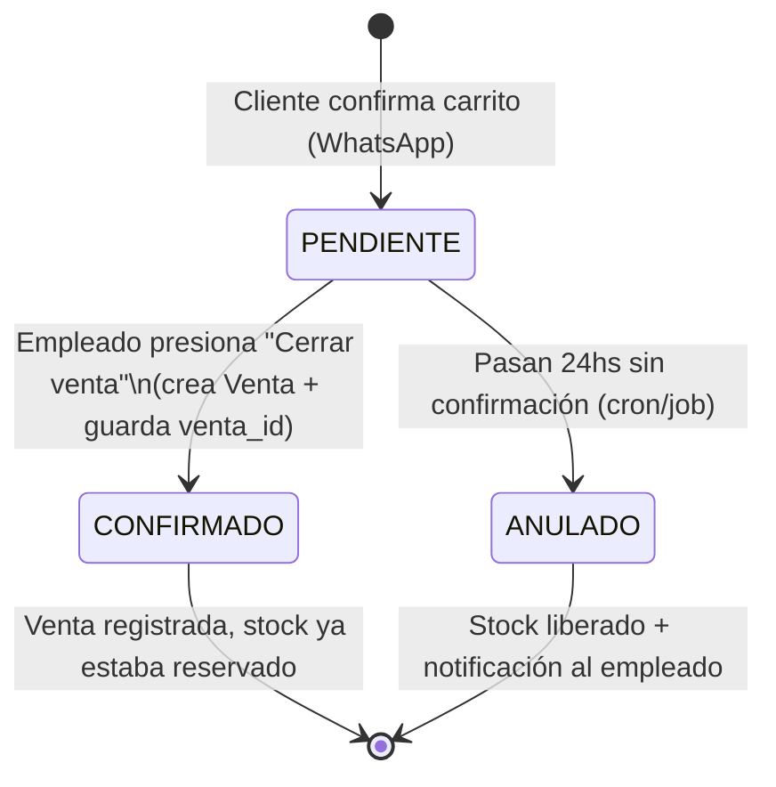
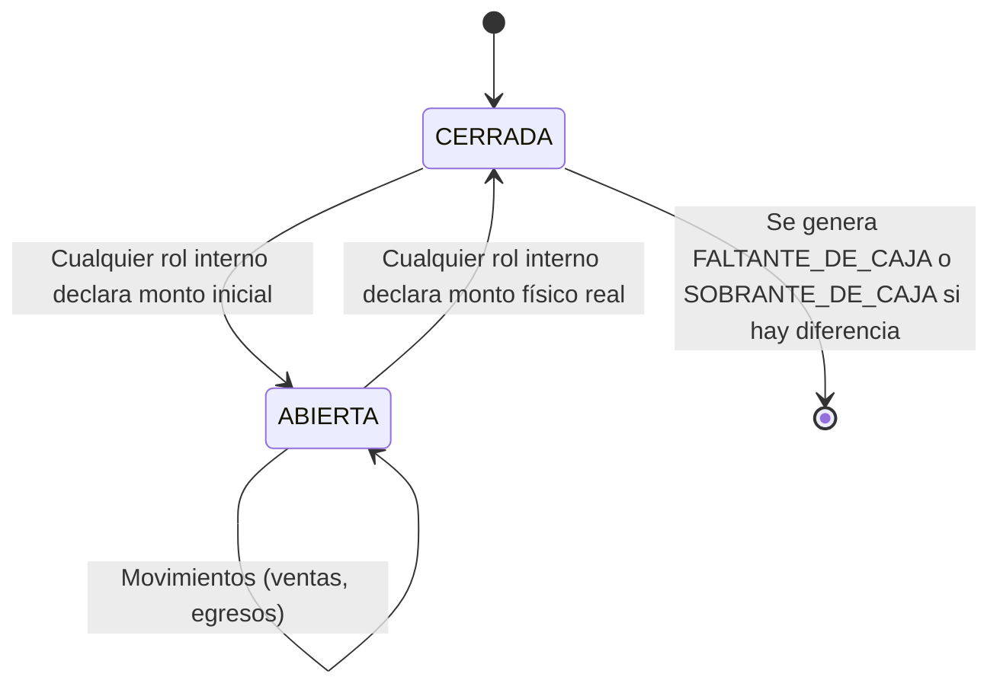
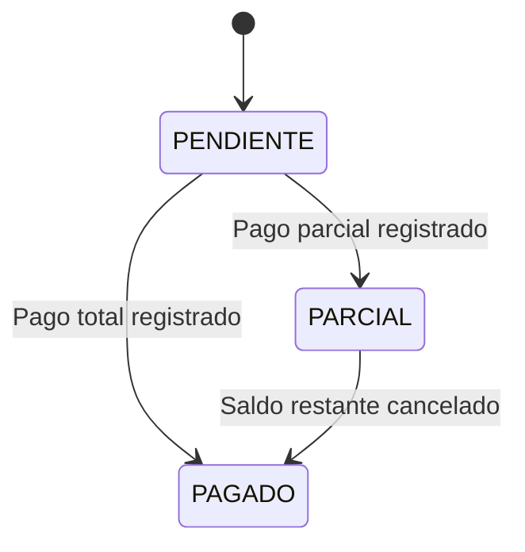

# Planificación del Proyecto — Sistema de Gestión para Local de Repuestos Celulares

> Documento vivo. Se irá ajustando a medida que el proyecto avance.
>
> **Última auditoría contra el código real: 2026-09-21.** Se revisó módulo por módulo (products, sales, order,
> cash-register, customers, price-lists, expenses, suppliers, notifications, dashboard, attendance-records, auth,
> users) y se corrigieron 5 desvíos entre lo escrito acá y el comportamiento real: la excepción no documentada de
> BR-22 (cierre automático de fichajes abandonados a las 12hs), la resolución BR-08/BR-11 sobre qué métodos de
> pago tocan la caja física, el alcance real de BR-26 (incluye Proveedor), y dos rutas mal traducidas en la
> sección 3.5 (`/store/products` y el fichaje, que quedó documentado con sus rutas reales en la sección 5). De
> paso se detectó un problema de permisos real en el módulo de fichaje (no es un tema de redacción del documento)
> — ver el aviso ⚠️ en la sección 5.

---

## 0. Resumen ejecutivo

Sistema compuesto por:
- **Backend** (NestJS + PostgreSQL + Docker) — expone endpoints privados (panel de administración) y públicos (e-commerce).
- **Panel de administración** (Next.js, privado, RBAC) — gestión operativa del local (ventas, stock, caja, clientes) desde cualquier navegador, sin depender de una instalación local. Reemplaza a la app de escritorio planificada originalmente: al ser web, el dueño puede operar el sistema estando de viaje.
- **E-commerce** (Next.js, público) — catálogo, carrito, checkout que redirige a WhatsApp (sin pasarela de pago: decisión explícita del local para no "blanquear" ventas).

Objetivo del proyecto: **pieza de portfolio** que demuestre modelado de dominio complejo, arquitectura multi-frontend 100% web, testing, RBAC y buenas prácticas de DevEx (Docker one-click para backend+DB, README, deploy de ambos frontends accesible por link).

**Estado actual (ver detalle en la sección 1):** el backend de la Fase 1 (MVP) y la mayor parte de la Fase 2 ya están implementados y probados a mano contra una base Postgres real. Quedan pendientes, de lo planificado originalmente, BR-09 (garantías y devoluciones) y BR-13 (cotización del dólar), más toda la capa de frontend (ambas apps Next.js todavía son el scaffold por defecto de `create-next-app`, sin pantallas propias). El próximo paso inmediato es documentar la API con Swagger/OpenAPI antes de escribir tests formales.

---
---

## 0.5. Reglas de negocio (detalle completo)

Texto completo de cada regla, tal como se definieron originalmente. Las tablas de la sección 1 (MVP vs Fase 2)
referencian estas mismas reglas por número.

**BR-01 (Control de Stock Absoluto) — MVP.** No se permite procesar ninguna venta en el local físico si el stock
disponible del producto es igual a cero.

**BR-02 (Reserva de Pedidos Web) — MVP.** Los pedidos del e-commerce ingresan en estado PENDIENTE. El sistema
debe bloquear temporalmente las unidades solicitadas del stock disponible por un lapso de 24 horas. Pasado ese
tiempo sin confirmación del vendedor, las unidades se liberan automáticamente.

**BR-03 (Seguridad de Contraseñas) — MVP.** Toda contraseña de usuario (clientes, empleados y administradores)
debe cumplir con una política de complejidad estricta: mínimo 8 caracteres, al menos una mayúscula, un número y
un carácter especial.

**BR-04 (Control de Stock Crítico) — MVP.** El sistema debe emitir una alerta visual cuando el stock de un
producto sea menor o igual a su `stock_minimo` definido, o cuando llegue a cero.

**BR-05 (Datos Obligatorios de Clientes Web) — MVP.** Para registrar una cuenta en el e-commerce, el sistema
exigirá de forma obligatoria: Nombre, Apellido, DNI, Celular, Dirección de residencia y Email. No se solicita
CUIL/CUIT (no aplica) ni dirección de entrega, ya que el local no realiza envíos — la compra se retira o se
coordina en persona, y la dirección se registra solo como dato de residencia del cliente.

**BR-06 (Matriz de Roles y Permisos) — MVP.** Se definen cuatro niveles de acceso al sistema, con jerarquía
Admin > Supervisor > Empleado:

| Módulo | Administrador (root) | Supervisor (encargado) | Empleado | Cliente Web |
|---|---|---|---|---|
| Inventario (ver) | Total | Total | Total | Solo lectura del catálogo (mismos productos/precios para todos los clientes; requiere login — BR-21) |
| Inventario (CRUD productos) | Total | Total | Solo ajustar stock | — |
| Ventas (registrar) | Total | Total | Total | — |
| Caja (apertura) | Total | Total | Total | — |
| Caja (cierre, BR-19) | Total | Total | Total (queda registrado para auditoría posterior de Supervisor/Admin) | — |
| Clientes (ver) | Total | Total | Total | Solo su propio perfil |
| Pedidos web (cerrar venta) | Total | Total | Total | Crear pedido propio |
| Proveedores / Compras | Total | Total | Solo lectura | — |
| Egresos: Proveedores/Insumos/Limpieza | Total | Total | Total | — |
| Egresos: Sueldos de Empleados | Total | Total (los gestiona) | Sin acceso | — |
| Pago/sueldo del propio Supervisor | Lo carga el Admin | Solo puede ver el propio (no editar) | Sin acceso | — |
| CRUD de Empleados | Total | Total | Sin acceso | — |
| CRUD de Supervisores | Total | Sin acceso (nivel exclusivo Admin) | Sin acceso | — |
| Dashboard / métricas (Fase 2) | Total | Total (encargado del local) | Sin acceso | — |
| Fichaje (check-in/check-out) | — (no ficha) | — (no ficha, ver BR-22) | Propio, automático | — |
| Horas trabajadas (ver) | Total (todos los Empleados) | Total (todos los Empleados) | Solo lectura, propias | — |
| Cálculo de pago por hora | Total | Total (gestiona pago de Empleados) | Sin acceso | — |
| Devoluciones (ver y registrar, BR-09) | Total | Total | Total | — |
| Devoluciones (decidir reingreso/derivar a proveedor) | Total | Total | Sin acceso | — |
| Cuentas corrientes / fiado (ver saldos, BR-18) | Total | Total | Total (para poder hacer seguimiento de cobro) | Solo su propio saldo |
| Cotización del dólar (BR-13) | Total | Total | Total (solo referencia visual, no es un dato restringido) | — |

**BR-20 (Jerarquía y Gestión de Usuarios Internos) — MVP.** El Administrador ("root") puede crear cuentas de
Supervisor y de Empleado. El Supervisor ("encargado") puede crear y gestionar cuentas de Empleado (CRUD
completo), pero no puede crear, editar ni eliminar cuentas de Supervisor — eso queda exclusivamente al nivel
Administrador. El Empleado no gestiona ninguna cuenta de usuario. No existe autorregistro de cuentas
Admin/Supervisor/Empleado: se crean únicamente desde el panel (por un rol superior) o directamente en la base de
datos (carga inicial).

**BR-21 (Acceso Autenticado Obligatorio al E-commerce) — MVP.** Todas las rutas del e-commerce, incluido el
catálogo de productos, requieren una sesión de Cliente Web iniciada — no existe navegación pública/anónima.
Motivo de negocio: (1) evitar que la competencia vea de forma abierta el catálogo de productos y precios, y (2)
el modelo de negocio no busca captar clientes nuevos a través del e-commerce (eso ocurre por otros canales:
redes sociales, venta en el local) sino ofrecer un canal directo a la cartera de clientes ya existente.

**BR-22 (Fichaje de Empleados / Check-in y Check-out) — MVP.** Al iniciar sesión en el panel de administración,
el sistema registra automáticamente el **check-in** del Empleado. El **check-out** se registra únicamente cuando
el Empleado cierra sesión de forma manual desde el panel (botón "Cerrar sesión") — el sistema **no expira la
sesión automáticamente** ni cierra el fichaje por inactividad o cierre de pestaña, para que el panel quede
siempre disponible durante la jornada sin cortes indeseados. Si el Empleado ya tiene un check-in abierto (no
hizo logout) y vuelve a iniciar sesión, el sistema reutiliza el fichaje abierto en vez de crear uno nuevo, para
no duplicar horas. El Empleado puede consultar en modo solo lectura sus propios días y horas trabajados. El
Supervisor y el Administrador pueden ver las horas trabajadas de cualquier Empleado y, al momento de cargar su
pago, el sistema calcula automáticamente el monto a pagar en base a un valor por hora configurado para cada
Empleado (horas trabajadas × valor hora). Esta regla aplica exclusivamente a Empleados — el Supervisor no ficha,
su pago se arregla de forma directa con el Administrador (ver BR-20).

**Excepción — cierre de emergencia por fichaje abandonado (implementada, no estaba en la versión original de esta
regla).** Como red de seguridad para fichajes que nunca se cerraron manualmente (ej. el Empleado cerró la pestaña
sin presionar "Cerrar sesión" y no volvió a loguearse), un cron (`@Cron(EVERY_10_MINUTES)`) revisa los fichajes
abiertos y cierra automáticamente cualquier `check_in` de más de 12 horas de antigüedad, marcándolo `autoClosed =
true` (para distinguirlo de un cierre manual real) y revocando el refresh token de esa cuenta, lo que fuerza un
nuevo login la próxima vez que se use. Esto **no** es una expiración por inactividad dentro de una jornada normal
— 12hs excede cualquier turno real del local — sino un límite superior para que un fichaje nunca quede abierto
indefinidamente por error. Queda pendiente decidir si el frontend debe avisar al Empleado cuando esto le pasó.

**BR-23 (Recuperación de Contraseña) — MVP.** El mecanismo de recuperación difiere según el tipo de cuenta:
- **Cliente Web:** flujo estándar de "olvidé mi contraseña" vía email, con un enlace/token de recuperación de
  duración limitada, enviado con **Resend** (servicio de email transaccional; se eligió por su buena integración
  con React/Next.js vía `react-email` para las plantillas, y un plan gratuito de 3.000 emails/mes que alcanza de
  sobra para este proyecto). La nueva contraseña debe cumplir la política de BR-03.
- **Usuario interno (Admin/Supervisor/Empleado):** no hay recuperación por email. El rol inmediatamente superior
  en la jerarquía resetea la contraseña directamente desde el panel — el Administrador puede resetear a
  cualquier cuenta, el Supervisor solo a cuentas de Empleado (coherente con BR-20). El reseteo genera una
  contraseña temporal; en el próximo login, el sistema obliga a esa cuenta a definir una contraseña nueva antes
  de dejarla operar.
- **Caso especial — el propio Administrador pierde su contraseña:** no existe un rol superior al Admin dentro
  del sistema que pueda resetearlo desde el panel. Queda **fuera del alcance del MVP** resolverlo por producto;
  en la práctica requeriría una acción directa sobre la base de datos (ej: un script o consulta manual). Se
  documenta como limitación conocida, no como funcionalidad a construir.

**BR-24 (Internacionalización — Selector de Idioma) — MVP.** Tanto el e-commerce como el panel de administración
deben permitir alternar entre **Español** (idioma por defecto) e **Inglés**, mediante un selector visible en la
interfaz. Se implementa con **next-intl** (librería de i18n idiomática para Next.js App Router) en ambas apps.
Motivo de negocio: al ser este un proyecto de portfolio que puede evaluarse desde empresas de habla inglesa, el
soporte multi-idioma suma valor de demostración técnica más allá de la necesidad real del local (que opera en
español). No aplica al contenido cargado por el local (nombres de producto, categorías, etc.) — esos quedan
en el idioma en que se cargaron; el selector traduce únicamente los textos fijos de la interfaz (labels, botones,
mensajes del sistema).

**BR-25 (Búsqueda y Filtros de Productos) — MVP.** Tanto el catálogo del e-commerce como el listado de inventario
del panel de administración deben permitir: búsqueda por nombre (coincidencia parcial, sin importar
mayúsculas/minúsculas), filtro por categoría, y ordenamiento por precio (ascendente/descendente) y por nombre
(A-Z / Z-A). Estos filtros se combinan entre sí (ej: buscar "pantalla" + categoría "Pantallas" + ordenado por
precio ascendente).

**BR-26 (Política de Borrado: Soft-Delete Condicional) — MVP.** Ningún `Producto`, `Usuario` (Empleado/
Supervisor), `Cliente` ni `Proveedor` se elimina físicamente de la base de datos si tiene registros históricos que
dependen de él (ventas, detalles de venta, movimientos de caja, fichajes, pedidos web, egresos, devoluciones,
etc.). En ese caso, la acción "eliminar" marca el registro como inactivo (`activo = false`) — deja de aparecer en
listados e inventario/altas nuevas, pero se conserva para no romper la trazabilidad de ventas o registros pasados.
Si el registro **no tiene ninguna dependencia histórica** (ej: un producto que se cargó por error y nunca se
vendió, una cuenta de Empleado que nunca fichó ni vendió nada, un Cliente que se registró pero nunca hizo un
pedido, una compra ni tiene devoluciones, o un Proveedor que nunca tuvo un egreso cargado), la acción "eliminar"
sí lo borra físicamente de la base — no tiene sentido conservar un registro "inactivo" que nunca se usó. Esta
verificación la hace el backend antes de decidir qué tipo de borrado aplica, de forma transparente para quien usa
el botón "Eliminar" (misma acción en la interfaz, comportamiento distinto por detrás según corresponda). Para
`Cliente` puntualmente, la eliminación es una acción exclusiva del staff interno (Admin, Supervisor o Empleado,
sin restricción jerárquica entre ellos) — el propio Cliente Web no tiene forma de autogestionar el borrado de su
cuenta. `Proveedor` sigue el mismo criterio que `Cliente` (verificación contra `Expense`, no formaba parte del
alcance original de esta regla pero se implementó con la misma lógica por consistencia).

**BR-27 (Verificación de Email) — MVP.** Toda cuenta de Cliente Web requiere confirmar su dirección de email
antes de poder iniciar sesión. Al registrarse (BR-05), la cuenta se crea con `email_verificado = false` y el
sistema genera un token de verificación con vencimiento, enviado por email (vía Resend, misma infraestructura de
BR-23). Mientras `email_verificado` sea `false`, cualquier intento de login devuelve 403 con un mensaje
indicando que falta confirmar la cuenta — no se permite operar el e-commerce sin verificar. Si el cliente cambia
su email desde su propio perfil, el email nuevo no reemplaza al actual de inmediato: se guarda en un campo
temporal (`pending_email`) junto con su propio token de verificación, y el cliente sigue pudiendo loguearse con
su email anterior hasta confirmar el nuevo. Al confirmar el link, `email` pasa a valer lo que tenía
`pending_email`, y este último vuelve a `null`. Esto evita que un cliente quede sin acceso a su cuenta por
haberse equivocado al tipear el nuevo email o por no llegar a confirmarlo.

**BR-07 (Multi-lista de Precios) — Fase 2. ✅ Implementada.** El sistema permite la creación de múltiples listas de
precios con **nombre libre definido por el local** (ej: "Lista de precios mayorista", "Lista Técnicos", no hay un
catálogo fijo de nombres). A diferencia de lo planteado originalmente, cada lista **no queda atada a una fórmula
que se recalcula sola**: al crearla, el sistema copia el precio base vigente de cada producto activo tal cual está
en ese momento, y de ahí en adelante esa lista vive de forma independiente. Sobre esa base, el local puede
modificar precios de dos formas: editando el valor final de un producto puntual (equivalente a "corregilo a
mano"), o aplicando un porcentaje de recargo/descuento sobre **los valores actuales** de todos los productos de la
lista de una sola vez (una acción, no una propiedad guardada de la lista — se puede repetir cuantas veces haga
falta, y cada vez que se aplica compone sobre el resultado anterior, nunca se recalcula desde el precio base
original). Cada lista podrá **exportarse a PDF** para enviar a clientes (mostrando únicamente el precio de venta
de esa lista, nunca el costo/precio de compra interno). El Administrador o Supervisor podrá marcar, mediante una
acción explícita ("Usar esta lista en e-commerce"), cuál de las listas es la que ve el Cliente Web en el catálogo
público — solo una lista puede estar activa para el e-commerce a la vez.

Al registrar una venta en el local, el vendedor podrá seleccionar **de forma opcional** una lista de precios: al
agregar un producto, el precio unitario se completa automáticamente con el valor de esa lista. Sin embargo, las
listas son solo una guía en el momento de cargar la venta — el vendedor puede modificar el precio de cada ítem
agregado a mano, y también puede quitar cualquier ítem de la venta antes de confirmarla. La venta en sí no guarda
una referencia permanente a qué lista se usó: el precio ya quedó fijado en cada línea de detalle en el momento de
la carga, así que no hace falta arrastrar esa relación más allá de ese instante. Además, existe una acción
"Aplicar descuento" para aplicar un porcentaje de descuento general sobre el total de la venta, sin tener que
editar cada línea de forma individual.

**BR-08 (Control de Flujo de Caja) — MVP.** Toda transacción **en Efectivo** del local (ventas o gastos menores)
requiere obligatoriamente una "Apertura de Caja" activa con su respectivo monto inicial. El sistema bloqueará
estas operaciones si la caja del día no ha sido iniciada. *(Corrección respecto de la redacción original, que
decía "efectivo/débito": Débito no toca la caja física, ver la nota de implementación en la sección 3 y BR-11.)*

**BR-09 (Flujo de Garantías y Devoluciones) — Fase 2. Pendiente.** Los productos devueltos ingresarán a un
estado de aislamiento (`inventario_devolucion`) registrando cliente, fecha y motivo. Cualquier rol interno
(Administrador, Supervisor o Empleado) puede ver el listado y registrar una devolución nueva — no es información
hermética. La decisión de reingresar el producto al stock común o derivarlo a una orden de devolución al
proveedor queda a cargo del Administrador o Supervisor.

**BR-10 (Categorización de Egresos) — MVP.** El módulo de compras/gastos registrará egresos clasificándolos en:
Proveedores, Insumos de Oficina, Limpieza y Sueldos. Los registros de sueldos serán estrictamente confidenciales
y omitidos para el rol Empleado.

**BR-11 (Trazabilidad de Métodos de Pago) — MVP.** Toda transacción (ingreso o egreso) debe especificar su
método financiero: Efectivo (afecta caja física), Tarjeta o Transferencia (afectan cuentas bancarias).

**BR-12 (Recargos Automatizados por Financiación) — Fase 2. ✅ Implementada.** El sistema permite configurar
coeficientes de recargo por cantidad de cuotas (una tabla editable de "cuotas → porcentaje de recargo"), que se
aplican automáticamente al total de una venta con tarjeta de crédito según la cantidad de cuotas seleccionada.

**BR-13 (Integración Cambiaria - Cotización Dólar) — Fase 2. Pendiente.** El panel de administración consumirá
una API externa para mostrar en tiempo real las cotizaciones del dólar en Argentina (Oficial, Blue, Tarjeta),
sirviendo como referencia para la toma de decisiones de precios.

**BR-14 (Auditoría e Historial de Costos) — Fase 2. ✅ Implementada.** Los cambios en los precios de los
productos no sobrescriben los registros anteriores. El sistema mantiene un histórico indexado por fecha,
guardando tanto el costo interno como el precio de venta vigente en cada momento (no solo uno de los dos), para
poder reconstruir el margen real de una venta pasada aunque el costo del producto haya cambiado después.

**BR-15 (Métricas de Negocio / Dashboard) — Fase 2. ✅ Implementada.** El panel de administración genera reportes
sobre un rango de fechas elegido por quien consulta (el frontend puede ofrecer atajos como "esta semana", "este
mes" o "este año", pero el backend simplemente recibe una fecha de inicio y una de fin), midiendo: volumen de
ventas, margen de ganancia neta —reconstruido a partir del histórico de costos de BR-14, no del costo actual del
producto— y cantidad de clientes nuevos captados en ese período.

**BR-16 (Alertas de Retención de Clientes) — Fase 2. ✅ Implementada.** El sistema audita de forma automatizada
la actividad de los clientes. En vez de un único aviso a los 20 días, la auditoría trabaja con varios umbrales
crecientes (20, 40, 60, 90 y 180 días sin comprar) y genera una notificación nueva cada vez que un cliente cruza
uno de esos umbrales, tomando como referencia su última compra o, si nunca compró, su fecha de registro. Pasados
los 180 días no se generan más avisos para ese cliente: se considera que después de medio año sin actividad ya
no tiene sentido seguir insistiendo con la retención. El detalle de esta lógica está en la sección 4.4.

**BR-17 (Gestión Operativa de Pedidos Vencidos) — MVP.** Al cumplirse el plazo de 24 horas de un pedido web sin
confirmación, el backend cambiará su estado a ANULADO. El panel de administración emitirá una notificación
obligatoria indicando el número de pedido y el desglose de productos para que el operario los retire del
estante de reservas y los reingrese físicamente al mostrador.

**BR-18 (Gestión de Cuentas Corrientes / Fiado) — Fase 2. ✅ Implementada.** El sistema admite transacciones
(ventas y egresos a proveedores) bajo la modalidad de crédito o pago parcial. Toda venta o egreso a proveedor
registra un estado de pago (PAGADO, PARCIAL o PENDIENTE) y, cuando corresponde, un monto efectivamente cobrado o
pagado. Las deudas se acumulan en un saldo mantenido directamente sobre el Cliente o el Proveedor (ver nota de
implementación en la sección 3), disparando alertas visuales en el panel de administración. La liquidación de
esas deudas (registrar un cobro o un pago parcial contra el saldo existente) queda fuera de esta primera vuelta:
el diseño actual la deja como una operación inversa simple de agregar más adelante, sin requerir cambios de
modelo.

**BR-19 (Auditoría de Cierre de Caja) — MVP (adelantada desde Fase 2).** Al finalizar la jornada, cualquier
usuario interno (Administrador, Supervisor o Empleado) puede declarar el "Monto Físico Real" en efectivo —no
siempre hay un Supervisor presente en el local para hacerlo—. El sistema contrastará este valor con el "Monto
Teórico" (calculado según el saldo inicial y los movimientos del día). Cualquier discrepancia se asentará
automáticamente en el historial contable como un egreso por FALTANTE_DE_CAJA o un ingreso por SOBRANTE_DE_CAJA.
Todo cierre queda registrado con el usuario que lo realizó y una fecha/hora, para que el Supervisor o
Administrador pueda auditarlo cuando lo necesite.

---

## 1. Alcance: MVP vs Fase 2

Con 26 reglas de negocio, 2 frontends, RBAC, e2e y monorepo, el riesgo original de un desarrollador solo sería
**no terminar nunca**. Ese riesgo se relativiza en este proyecto puntual porque la implementación real la hace
Claude (no una sola persona limitada por horas-hombre) — así que este documento funciona más como una **guía de
documentación de un proyecto real** (para mostrar el proceso completo en el portfolio) que como un corte de
alcance defensivo. Aun así, se mantiene el orden MVP/Fase 2 como referencia de prioridad e implementación
incremental — separar en pasos sigue siendo valioso para poder probar y depurar cada parte antes de sumar la
siguiente (la lección de los problemas de Docker/Prisma de la primera vuelta de este proyecto).

### MVP (Fase 1) — implementado en el backend
| BR | Feature | Estado |
|---|---|---|
| BR-01 | Bloqueo de venta con stock 0 | ✅ |
| BR-02 | Reserva de stock 24hs en pedidos web | ✅ |
| BR-03 | Política de contraseñas | ✅ |
| BR-04 | Alerta visual de stock crítico (barata, buen impacto visual) | ✅ |
| BR-05 | Registro obligatorio de clientes web | ✅ |
| BR-06 | RBAC (Admin / Supervisor / Empleado / Cliente Web) | ✅ |
| BR-08 | Apertura de caja obligatoria | ✅ |
| BR-10 | Categorización de egresos + ocultar sueldos al Empleado (completa el sentido de BR-06) | ✅ |
| BR-11 | Método de pago en cada transacción | ✅ |
| BR-17 | Anulación automática de pedidos vencidos + notificación | ✅ |
| BR-19 | Auditoría de cierre de caja (Admin y Supervisor) | ✅ |
| BR-20 | Jerarquía y gestión de usuarios internos (Admin crea Supervisores/Empleados; Supervisor solo crea Empleados) | ✅ |
| BR-21 | Acceso autenticado obligatorio al e-commerce (sin navegación pública) | ✅ |
| BR-22 | Fichaje de Empleados (check-in/check-out) + cálculo de pago por hora | ✅ |
| BR-23 | Recuperación de contraseña (email para Cliente; reseteo jerárquico para cuentas internas) | ✅ |
| BR-24 | Internacionalización: selector Español/Inglés en ambas apps (next-intl) | Pendiente (frontend no iniciado) |
| BR-25 | Búsqueda por nombre, filtro por categoría y ordenamiento por precio/nombre en catálogo e inventario | ✅ |
| BR-26 | Borrado condicional (soft-delete si hay historial, borrado físico si no) para Producto, Usuario, Cliente y Proveedor | ✅ |
| BR-27 | Verificación de email al registrarse y al cambiar email desde el perfil (Cliente Web) | ✅ |
| — | Catálogo (requiere login — BR-21) + carrito + flujo WhatsApp | Pendiente (frontend no iniciado) |
| — | Cierre de venta (empleado) descuenta stock | ✅ |

### Fase 2 — estado real a la fecha de este documento
| BR | Feature | Estado |
|---|---|---|
| BR-07 | Multi-lista de precios (+ exportar a PDF, marcar lista activa para e-commerce) | Backend ✅ / exportar a PDF pendiente |
| BR-09 | Garantías y devoluciones | Pendiente |
| BR-12 | Recargos por financiación | ✅ |
| BR-13 | Cotización dólar (API externa) | Pendiente |
| BR-14 | Histórico de precios | ✅ |
| BR-15 | Dashboard de métricas | ✅ |
| BR-16 | Alertas de cliente inactivo (rediseñada como sistema de umbrales, ver BR-16 arriba) | ✅ |
| BR-18 | Cuentas corrientes / fiado (rediseñada respecto del ERD original, ver sección 3) | ✅ |

De la Fase 2, quedan dos features sin arrancar (BR-09 y BR-13) y la exportación a PDF de las listas de precios
dentro de BR-07. El resto del backend de Fase 2 está cerrado. Lo que sigue pendiente en su totalidad es la capa
de frontend: ninguna de las dos apps Next.js tiene pantallas propias todavía, más allá del scaffold inicial.

**Sugerencia original, todavía vigente:** aun si algo de Fase 2 queda sin terminar, elegir 2-3 features
"vistosas" (Dashboard con gráficos, cotización dólar en tiempo real) da buen impacto visual en una demo/entrevista
con poco esfuerzo relativo — el Dashboard ya está del lado del backend, así que en cuanto haya frontend es la
primera candidata a mostrarse bien.

---

## 2. Historias de usuario

Formato: `Como <rol>, quiero <acción>, para <beneficio>` + criterios de aceptación (Given/When/Then).

### Módulo: Autenticación y Roles

**HU-01** — Como visitante, quiero registrarme en el e-commerce, para poder ver el catálogo, comprar y ver mi historial.
- Dado que completo el formulario sin uno de los campos obligatorios (Nombre, Apellido, DNI, Celular, Dirección de residencia, Email), cuando envío el formulario, entonces el sistema rechaza el registro indicando el campo faltante. *(BR-05)*
- Dado que mi contraseña no cumple la política (8+ caracteres, mayúscula, número, carácter especial), cuando intento registrarme, entonces el sistema rechaza la contraseña y explica el motivo. *(BR-03)*
- Dado que no tengo sesión iniciada, cuando intento acceder a cualquier ruta del e-commerce (incluido el catálogo), entonces el sistema me redirige a login/registro sin mostrar ningún producto ni precio. *(BR-21)*

**HU-01b** — Como Cliente Web recién registrado, quiero confirmar mi email antes de poder operar la tienda, para que el sistema garantice que la cuenta pertenece a un email real.
- Dado que me registro, cuando el registro se completa, entonces el sistema crea la cuenta con `email_verificado = false` y envía un email con un enlace de confirmación. *(BR-27)*
- Dado que intento iniciar sesión sin haber confirmado el email, cuando envío mis credenciales, entonces el sistema devuelve 403 indicando que falta verificar la cuenta, aunque la contraseña sea correcta. *(BR-27)*
- Dado un enlace de confirmación válido y no vencido, cuando lo abro, entonces `email_verificado` pasa a `true` y ya puedo iniciar sesión normalmente. *(BR-27)*

**HU-02** — Como Administrador, quiero crear cuentas de Supervisor y de Empleado, para delegar la operación y gestión del local.
- Dado que creo un usuario con rol Empleado, cuando ese usuario intenta acceder al módulo de Sueldos, entonces el sistema devuelve 403. *(BR-06, BR-10)*
- Dado que creo un usuario con rol Supervisor, cuando ese usuario inicia sesión, entonces tiene acceso a todos los módulos operativos del local (inventario, ventas, caja, egresos, CRUD de Empleados) pero no puede crear ni editar otras cuentas de Supervisor. *(BR-06, BR-20)*

**HU-02b** — Como Supervisor, quiero crear y gestionar cuentas de Empleado, para armar el equipo operativo del local sin depender del Administrador para cada alta.
- Dado que soy Supervisor, cuando intento crear una cuenta con rol Supervisor o Administrador, entonces el sistema devuelve 403 — esa acción es exclusiva del Administrador. *(BR-20)*

**HU-03** — Como Empleado o Supervisor, quiero iniciar sesión en el panel de administración web, para acceder a mis módulos correspondientes desde cualquier navegador.
- Dado que soy Empleado, cuando intento acceder al módulo de Compras a proveedores, entonces solo puedo verlo en modo lectura. *(BR-06)*
- Dado que soy Empleado y no hay Supervisor presente en el local, cuando finalizo la jornada, entonces puedo cerrar la caja yo mismo declarando el monto físico; el cierre queda registrado con mi usuario para que el Supervisor lo audite después. *(BR-06, BR-19)*

**HU-03b** — Como Supervisor, quiero ver mi propio pago/sueldo (cargado por el Administrador), para llevar control de mi remuneración sin poder alterarla.
- Dado que soy Supervisor, cuando consulto la sección de mi pago, entonces veo el monto en modo solo lectura; no existe ninguna acción de edición disponible para ese registro. *(BR-06, BR-20)*

**HU-03i** — Como Cliente Web, quiero ver y editar mi propio perfil, para mantener mis datos de contacto actualizados.
- Dado que consulto mi perfil, cuando lo abro, entonces veo mis datos personales (nombre, apellido, DNI, celular, dirección, email) en modo lectura y edición según el campo. *(BR-06)*
- Dado que edito mi nombre, apellido, celular o dirección, cuando confirmo los cambios, entonces se actualizan de inmediato sin ninguna verificación adicional.
- Dado que intento editar mi DNI, cuando envío el cambio, entonces el sistema lo rechaza — ese campo no es editable desde el perfil; requiere contactar al local.
- Dado que cambio mi email, cuando confirmo el cambio, entonces el sistema guarda el nuevo valor en `pending_email` y envía un enlace de confirmación, mientras sigo pudiendo loguearme con mi email actual hasta confirmarlo. *(BR-27)*
- Dado que quiero cambiar mi contraseña, cuando busco esa opción en mi perfil, entonces el sistema me redirige al flujo de `/auth/olvide-password` — no existe un campo de password en este formulario. *(BR-23)*

### Módulo: Fichaje y Horas Trabajadas

**HU-03c** — Como Empleado, quiero que mi check-in se registre automáticamente al iniciar sesión, para no tener que fichar por separado.
- Dado que inicio sesión y no tengo un fichaje abierto, cuando el login se completa, entonces el sistema crea un registro de asistencia con `check_in = ahora`. *(BR-22)*
- Dado que inicio sesión y ya tengo un fichaje abierto (no hice logout la vez anterior), cuando el login se completa, entonces el sistema reutiliza ese fichaje en vez de crear uno nuevo. *(BR-22)*

**HU-03d** — Como Empleado, quiero que mi check-out se registre solo cuando cierro sesión manualmente, para que el sistema no me desloguee solo durante la jornada.
- Dado que estoy con sesión iniciada, cuando pasa el tiempo sin que yo haga nada, entonces el sistema no cierra mi sesión ni mi fichaje automáticamente. *(BR-22)*
- Dado que presiono "Cerrar sesión", cuando la acción se confirma, entonces el sistema registra `check_out = ahora` en mi fichaje abierto. *(BR-22)*

**HU-03e** — Como Empleado, quiero ver mis propios días y horas trabajadas en modo solo lectura, para llevar control de mi asistencia.
- Dado que consulto mi sección de horas trabajadas, cuando la abro, entonces veo mis check-in/check-out pasados sin ninguna opción de edición. *(BR-22)*

**HU-03f** — Como Supervisor o Administrador, quiero ver las horas trabajadas de los Empleados y calcular su pago automáticamente, para no tener que sumar horas a mano.
- Dado un Empleado con un valor por hora configurado, cuando consulto sus horas trabajadas en un rango de fechas, entonces el sistema calcula el monto a pagar como horas trabajadas × valor hora. *(BR-22)*

**HU-03g** — Como Cliente Web, quiero recuperar mi contraseña por email si me la olvido, para no perder el acceso a mi cuenta.
- Dado que pido "Olvidé mi contraseña" con mi email, cuando el email existe, entonces se genera un `reset_token` con vencimiento y se envía un enlace de recuperación. *(BR-23)*
- Dado un enlace de recuperación válido y no vencido, cuando defino una contraseña nueva, entonces el sistema valida que cumpla BR-03 y invalida el token usado. *(BR-23, BR-03)*

**HU-03h** — Como Administrador o Supervisor, quiero resetear la contraseña de una cuenta interna que perdió su acceso, para no depender de un flujo por email.
- Dado que soy Supervisor y reseteo la contraseña de un Empleado, cuando confirmo la acción, entonces se genera una contraseña temporal y `debe_cambiar_password = true`. *(BR-23, BR-20)*
- Dado que soy Supervisor, cuando intento resetear la contraseña de otro Supervisor o de un Administrador, entonces el sistema devuelve 403. *(BR-23, BR-20)*
- Dado un usuario con `debe_cambiar_password = true`, cuando inicia sesión con la contraseña temporal, entonces el sistema lo obliga a definir una contraseña nueva antes de dejarlo operar el resto del panel. *(BR-23)*

### Módulo: Inventario y Stock

**HU-04** — Como Empleado, quiero que el sistema bloquee la venta si el stock es 0, para no vender algo inexistente.
- Dado un producto con `stock_disponible = 0`, cuando intento agregarlo a una venta, entonces el sistema impide la operación y muestra un mensaje. *(BR-01)*

**HU-04b** — Como usuario del catálogo (Cliente Web) o del inventario (Empleado/Supervisor/Admin), quiero buscar y filtrar productos, para encontrar lo que necesito sin recorrer todo el listado.
- Dado que escribo un texto en el buscador, cuando el listado se actualiza, entonces solo muestra productos cuyo nombre contiene ese texto (sin importar mayúsculas/minúsculas). *(BR-25)*
- Dado que selecciono una categoría, cuando el listado se actualiza, entonces solo muestra productos de esa categoría. *(BR-25)*
- Dado que elijo ordenar por precio o por nombre, cuando el listado se actualiza, entonces respeta ese orden (ascendente o descendente según lo elegido). *(BR-25)*
- Dado que combino búsqueda + categoría + orden al mismo tiempo, cuando el listado se actualiza, entonces aplica los tres filtros juntos. *(BR-25)*

**HU-05** — Como Administrador o Empleado, quiero ver una alerta visual cuando el stock esté en o por debajo del mínimo, para reponer a tiempo.
- Dado un producto con `stock_disponible <= stock_minimo`, cuando visualizo el listado de inventario, entonces el producto aparece resaltado. *(BR-04)*

**HU-06** — Como Administrador o Supervisor, quiero gestionar múltiples listas de precios, para vender a Público, Técnico y Mayorista con recargos distintos.
- Dado que creo una lista de precios nueva, cuando la confirmo, entonces el sistema copia el precio base vigente de cada producto activo como punto de partida de esa lista. *(BR-07)*
- Dado que quiero ajustar los precios de una lista ya creada, cuando aplico un porcentaje de recargo o descuento sobre "todos los ítems", entonces el sistema recalcula cada precio de esa lista a partir de su valor actual, no del precio base original. *(BR-07)*
- Dado que quiero corregir un producto puntual dentro de una lista, cuando edito su precio a mano, entonces ese valor queda fijo ahí hasta el próximo ajuste, sin que lo pise ningún recálculo automático. *(BR-07)*
- Dado que quiero enviarle una lista a un cliente, cuando presiono "Exportar a PDF", entonces se genera un PDF con nombre de producto y precio de venta de esa lista, sin exponer nunca el precio de compra. *(BR-07 — exportación a PDF todavía no implementada)*
- Dado que quiero que el e-commerce muestre una lista en particular, cuando presiono "Usar esta lista en e-commerce" sobre una lista, entonces esa pasa a ser la única activa para el catálogo público y la que tenía el flag anteriormente se desactiva. *(BR-07)*

**HU-07** — Como Administrador, quiero ver el histórico de precios de un producto, para analizar su evolución.
- Dado que modifico el costo o el precio de venta de un producto, cuando confirmo el cambio, entonces se crea un nuevo registro histórico (con ambos valores) sin sobrescribir el anterior. *(BR-14)*

### Módulo: Ventas y Caja

**HU-08** — Como Empleado, quiero que el sistema impida registrar ventas si no hay una caja abierta, para mantener control de flujo de efectivo.
- Dado que no hay apertura de caja para el día, cuando intento registrar una venta en efectivo, entonces el sistema bloquea la operación. *(BR-08)*

**HU-08b** — Como Empleado, quiero elegir opcionalmente una lista de precios al registrar una venta, para que el precio de cada producto se autocomplete y no tener que buscarlo manualmente.
- Dado que selecciono una lista de precios antes de agregar productos, cuando agrego un producto a la venta, entonces su precio unitario se completa automáticamente con el valor de esa lista. *(BR-07)*
- Dado un producto ya agregado a la venta con precio autocompletado, cuando edito manualmente su precio, entonces el sistema respeta el valor editado por sobre el de la lista — la lista es solo una guía. *(BR-07)*
- Dado un producto agregado por error, cuando lo quito de la venta, entonces deja de sumar al total antes de confirmar. *(BR-07)*
- Dado que quiero aplicar un descuento general, cuando uso la acción "Aplicar descuento" e ingreso un porcentaje, entonces el sistema recalcula el precio de todos los ítems de la venta sin tener que editarlos uno por uno. *(BR-07)*

**HU-09** — Como Empleado, quiero indicar el método de pago de cada transacción, para que impacte correctamente en caja o cuentas bancarias.
- Dado que registro una venta con método "Tarjeta", cuando confirmo, entonces el monto no afecta el arqueo de caja física sino el registro de cuentas bancarias. *(BR-11)*

**HU-09b** — Como Empleado, quiero registrar una venta a crédito o con pago parcial, para llevar el saldo del cliente al día.
- Dado que registro una venta con estado PENDIENTE o PARCIAL, cuando la confirmo sin indicar un cliente, entonces el sistema rechaza la operación — una venta a crédito necesita saber a quién cobrarle después. *(BR-18)*
- Dado una venta PARCIAL con parte del monto pagado en efectivo, cuando se registra el movimiento de caja correspondiente, entonces el monto que impacta en el arqueo físico es lo efectivamente cobrado en efectivo, no el total de la venta. *(BR-18, BR-19)*

**HU-10** — Como Administrador, Supervisor o Empleado, quiero cerrar la caja declarando el monto físico real, para detectar diferencias.
- Dado un monto teórico calculado por el sistema y un monto físico declarado, cuando estos difieren, entonces se genera automáticamente un movimiento de FALTANTE_DE_CAJA o SOBRANTE_DE_CAJA. *(BR-19)*

**HU-11** — Como Administrador o Empleado, quiero configurar recargos por cantidad de cuotas, para ventas con tarjeta de crédito.
- Dado un coeficiente configurado para 6 cuotas, cuando se selecciona esa cantidad de cuotas en una venta, entonces el total se recalcula aplicando el recargo. *(BR-12)*

### Módulo: E-commerce y Pedidos Web

**HU-12** — Como Cliente Web, quiero armar un carrito y enviarlo por WhatsApp, para coordinar el pago con el local.
- Dado un carrito con productos, cuando confirmo la compra, entonces se genera un enlace `wa.me` con el texto preformateado y se crea una orden en estado PENDIENTE en el backend. *(flujo WhatsApp)*

**HU-13** — Como sistema, quiero reservar el stock de un pedido web por 24hs, para no vender el mismo producto dos veces.
- Dado un pedido en estado PENDIENTE, cuando pasan 24hs sin confirmación, entonces el stock reservado se libera y el pedido pasa a ANULADO. *(BR-02, BR-17)*

**HU-14** — Como Empleado, quiero ver una notificación de pedidos anulados por vencimiento, para retirar los productos del estante de reservas.
- Dado un pedido que pasa a ANULADO automáticamente, cuando el empleado abre la app, entonces ve una notificación con el número de pedido y el desglose de productos a reingresar al mostrador. *(BR-17)*

**HU-15** — Como Empleado, quiero cerrar la venta de un pedido web cuando el cliente confirma el pago, para que quede registrada como una venta real y trazable.
- Dado un pedido PENDIENTE con pago confirmado por privado, cuando presiono "Cerrar venta", entonces el sistema crea una `Venta` (con sus `DetalleVenta`, copiando productos/cantidades/precios del pedido), guarda el `id` de esa venta en `Pedido.venta_id`, y el pedido pasa a CONFIRMADO. El stock no vuelve a descontarse — ya se había reservado al crear el pedido. *(flujo WhatsApp, BR-02)*

### Módulo: Clientes y Cuentas Corrientes

**HU-16** — Como Administrador o Supervisor, quiero ver alertas de clientes inactivos, para acciones de retención.
- Dado un cliente cuya última compra (o fecha de registro, si nunca compró) supera alguno de los umbrales definidos (20, 40, 60, 90 o 180 días), cuando la auditoría automática corre, entonces se genera una notificación de "Cliente Inactivo" indicando ese umbral, solo si todavía no existe una notificación para ese mismo cliente y umbral desde la última compra registrada. *(BR-16)*
- Dado un cliente que ya superó los 180 días de inactividad y sigue sin comprar, cuando la auditoría vuelve a correr, entonces no se genera ninguna notificación nueva para él — el sistema deja de insistir después de ese umbral. *(BR-16)*

**HU-17** — Como Administrador, Supervisor o Empleado, quiero registrar ventas a crédito (fiado), para llevar el saldo de cuenta corriente de cada cliente.
- Dado una venta con estado de pago PARCIAL o PENDIENTE, cuando se confirma, entonces se suma la deuda generada (total menos lo efectivamente pagado) al saldo del cliente. *(BR-18)*

**HU-17b** — Como Empleado, quiero ver qué clientes tienen saldo pendiente, para poder contactarlos y hacer el seguimiento del cobro.
- Dado que consulto la lista de clientes con el filtro de deuda activado, cuando la abro, entonces veo únicamente a los clientes con saldo mayor a cero, no solo los que yo cargué. *(BR-18)*

### Módulo: Compras, Egresos y Devoluciones

**HU-18** — Como Administrador, Supervisor o Empleado, quiero clasificar los egresos por categoría, para tener trazabilidad contable.
- Dado un egreso registrado, cuando se selecciona la categoría "Sueldos", entonces ese registro queda oculto para el rol Empleado. *(BR-10)*

**HU-18b** — Como Administrador, Supervisor o Empleado, quiero registrar un egreso a proveedor a crédito o con pago parcial, para llevar el saldo que el local le debe a ese proveedor.
- Dado un egreso de categoría "Proveedores" con estado PARCIAL o PENDIENTE, cuando lo confirmo sin indicar un proveedor, entonces el sistema rechaza la operación. *(BR-18)*
- Dado un egreso a proveedor con estado PARCIAL o PENDIENTE, cuando se confirma, entonces se suma la diferencia entre el monto total y lo efectivamente pagado al saldo de ese proveedor. *(BR-18)*

**HU-19** — Como Empleado, quiero registrar la devolución de un producto que trae un cliente, para aislarlo del stock disponible hasta que se decida qué hacer.
- Dado un producto devuelto, cuando registro la devolución, entonces ingresa a `inventario_devolucion` con cliente, fecha y motivo, sin afectar el stock común. *(BR-09 — pendiente de implementar)*

**HU-19b** — Como Administrador o Supervisor, quiero decidir si un producto devuelto vuelve al stock o se deriva al proveedor, para resolver el caso.
- Dado un producto en `inventario_devolucion`, cuando decido reingresarlo, entonces vuelve al stock común; cuando decido derivarlo, entonces se genera una orden de devolución al proveedor. *(BR-09 — pendiente de implementar)*

### Módulo: Dashboard e Integraciones

**HU-20** — Como Administrador o Supervisor, quiero ver un dashboard con métricas de ventas, margen y adquisición de clientes, para tomar decisiones.
- Dado un rango de fechas elegido, cuando accedo al dashboard, entonces veo los tres indicadores calculados para ese período. *(BR-15)*

**HU-21** — Como cualquier rol interno (Admin, Supervisor o Empleado), quiero ver la cotización del dólar (Oficial, Blue, Tarjeta) en un costado de la pantalla, para tener una referencia rápida de precios.
- Dado que el panel de administración web inicia sesión, cuando se carga el panel principal, entonces se consulta la API externa y se muestran las tres cotizaciones a cualquier rol logueado; si la API falla, se muestra el último valor cacheado con aviso. *(BR-13 — pendiente de implementar)*

---

## 3. Modelo de datos (ERD)

> Aclaración: `PRODUCTO` es el artículo individual (una fila = un producto puntual, con su propio stock y
> precio). No existe una entidad "Catálogo" separada — el catálogo que ve el Cliente Web es simplemente el
> listado de filas de `PRODUCTO`, filtrado por la lista de precios activa (BR-07).
>
> `CLIENTE` y `USUARIO` se mantienen como tablas separadas a propósito: `Cliente` tiene datos personales de
> terceros externos (DNI, dirección, celular) y `Usuario` va a tener datos sensibles propios del personal
> (sueldo/pago de Supervisor, BR-20). Separarlas evita que un dato sensible de sueldo pueda filtrarse alguna vez
> hacia el contexto del e-commerce por error de código — ya ni siquiera están en la misma tabla. El login sí
> comparte una única función que busca primero en `Usuario` y luego en `Cliente`; el valor `CLIENTE` que ven los
> guards de rol (`@Roles(...)`) en el backend es un valor asignado en tiempo de ejecución al firmar el JWT —no
> existe una columna `rol = CLIENTE` en ninguna tabla, ya que toda fila de `Cliente` es, por definición, un
> cliente.
>
> `PEDIDO` y `VENTA` también se mantienen separados: el pedido web tiene una mecánica que una venta del local no
> necesita (reserva de stock por 24hs con vencimiento automático — BR-02/BR-17); unificarlos dejaría ese campo
> vacío en todas las ventas locales y obligaría a filtrar por origen en casi todos lados igual.
>
> **Nota de implementación — BR-18 (cuentas corrientes):** el ERD original modelaba una tabla `CUENTA_CORRIENTE`
> con FK opcional a `Cliente` o a `Proveedor` (uno de los dos siempre nulo), y la propia planificación ya marcaba
> esa ambigüedad como algo a revisar. En la implementación se optó por sacar esa tabla y llevar el saldo como un
> campo `balance` directamente en `Cliente` y en `Proveedor` — el mismo criterio que ya se usaba para
> `stock_disponible` en `Producto`: un valor que se mantiene incrementado por código en vez de recalcularse al
> vuelo. Esto evita la ambigüedad de la FK nula y saca una tabla entera del modelo sin perder información.
>
> **Nota de implementación — BR-07 (listas de precios):** el ERD original tenía un campo `porcentaje` en
> `LISTA_PRECIO`, pensado como una fórmula que se reaplicaba sola cuando cambiaba el precio base. Se descartó
> porque no refleja cómo se usa en la práctica: el porcentaje es un parámetro de una acción puntual ("aplicar
> este recargo a los precios actuales de esta lista"), no un dato permanente de la lista. Por eso no aparece como
> columna — la lista solo guarda el resultado (`precio_calculado` en `PRECIO_LISTA`), no la fórmula que lo generó.
>
> **Nota de implementación — Egresos a proveedores:** el ERD original tenía una entidad `COMPRA` separada, pensada
> solo para lo que el local le compra a sus proveedores. En la implementación, eso se resolvió con la misma tabla
> `EGRESO` que ya cubre las otras categorías de BR-10 (Insumos, Limpieza, Sueldos): un egreso con categoría
> `PROVEEDOR` lleva además el proveedor asociado y, si es a crédito, su estado de pago — no hizo falta una tabla
> aparte para lo mismo.
>
> **Nota de implementación — BR-08 vs. BR-11 (qué métodos de pago tocan la caja física):** BR-08 agrupa
> "efectivo/débito" como si ambos requirieran una Apertura de Caja activa, mientras que BR-11 aclara que solo
> Efectivo afecta la caja física (Tarjeta y Transferencia afectan cuentas bancarias). En la implementación se
> resolvió a favor de BR-11: tanto la validación de "caja abierta" como la generación de un `CAJA_MOVIMIENTO`
> ocurren únicamente cuando `metodoPago = EFECTIVO`. Una venta o egreso con Tarjeta de Débito **no** requiere caja
> abierta ni genera movimiento de caja — solo queda registrado en la propia `Venta`/`Egreso` con su método de
> pago, para las métricas de BR-15. BR-08 debería reformularse para decir "Efectivo" en vez de "efectivo/débito".

```mermaid
erDiagram
    USUARIO ||--o{ VENTA : "registra"
    USUARIO ||--o{ REGISTRO_ASISTENCIA : "ficha (solo Empleado)"
    USUARIO {
        uuid id PK
        string nombre
        string apellido
        string dni
        string direccion
        string telefono
        string email
        string password_hash
        enum rol "ADMIN|SUPERVISOR|EMPLEADO"
        decimal valor_hora "solo aplica a Empleado, para BR-22"
        boolean debe_cambiar_password "true tras un reseteo jerárquico — BR-23"
        boolean activo "soft-delete condicional — BR-26"
        datetime fecha_creacion
    }

    REGISTRO_ASISTENCIA {
        uuid id PK
        uuid usuario_id FK
        datetime check_in
        datetime check_out "nulo hasta que el Empleado cierra sesión manualmente"
    }

    CLIENTE ||--o{ PEDIDO : "realiza"
    CLIENTE ||--o{ VENTA : "compra"
    CLIENTE {
        uuid id PK
        string nombre
        string apellido
        string dni
        string celular
        string direccion
        string email
        string password_hash
        string reset_token "nulo, se genera al pedir 'olvidé mi contraseña' — BR-23"
        datetime reset_token_expira "nulo, vencimiento del enlace de recuperación"
        boolean email_verificado "default false — BR-27"
        string email_verificacion_token "nulo, token pendiente de confirmación — BR-27"
        datetime email_verificacion_expira "nulo, vencimiento del enlace de verificación — BR-27"
        string pending_email "nulo, nuevo email aún sin confirmar tras un cambio de perfil — BR-27"
        decimal balance "saldo de cuenta corriente, default 0 — BR-18 (ver nota de implementación arriba)"
        boolean activo "soft-delete condicional — BR-26"
    }

    PRODUCTO ||--o{ DETALLE_VENTA : "incluye"
    PRODUCTO ||--o{ PRECIO_HISTORICO : "tiene"
    PRODUCTO ||--o{ PRECIO_LISTA : "define"
    PRODUCTO ||--o{ INVENTARIO_DEVOLUCION : "puede estar en"
    PRODUCTO {
        uuid id PK
        string nombre
        string categoria
        int stock_disponible
        int stock_minimo
        decimal costo "precio de compra interno, nunca expuesto al Cliente Web — BR-07"
        decimal precio_base
        boolean activo "soft-delete condicional — BR-26"
    }

    LISTA_PRECIO ||--o{ PRECIO_LISTA : "aplica"
    LISTA_PRECIO {
        uuid id PK
        string nombre "nombre libre definido por el local — BR-07"
        boolean activa_ecommerce "solo una lista puede estar en true a la vez"
    }

    PRECIO_LISTA {
        uuid id PK
        uuid producto_id FK
        uuid lista_id FK
        decimal precio_calculado
    }

    PRECIO_HISTORICO {
        uuid id PK
        uuid producto_id FK
        decimal costo
        decimal precio_venta
        datetime fecha_creacion
    }

    PEDIDO ||--o{ DETALLE_PEDIDO : "contiene"
    PEDIDO |o--o| VENTA : "genera al confirmarse (HU-15)"
    PEDIDO {
        uuid id PK
        uuid cliente_id FK
        uuid venta_id FK "nulo hasta 'Cerrar venta'; trazabilidad directa al confirmar"
        enum estado "PENDIENTE|CONFIRMADO|ANULADO"
        datetime fecha_creacion
        datetime fecha_vencimiento_reserva
    }

    DETALLE_PEDIDO {
        uuid id PK
        uuid pedido_id FK
        uuid producto_id FK
        int cantidad
    }

    VENTA ||--o{ DETALLE_VENTA : "contiene"
    VENTA ||--o| CAJA_MOVIMIENTO : "genera"
    VENTA {
        uuid id PK
        uuid cliente_id FK "opcional, venta de mostrador sin cliente identificado"
        uuid usuario_id FK
        decimal descuento_general_porcentaje "opcional, aplicado con 'Aplicar descuento'"
        enum metodo_pago "EFECTIVO|TARJETA_DEBITO|TARJETA_CREDITO|TRANSFERENCIA"
        enum estado_pago "PAGADO|PARCIAL|PENDIENTE — BR-18"
        int cuotas
        decimal recargo_cuotas
        decimal total
        decimal monto_pagado "lo efectivamente cobrado; total - monto_pagado es la deuda generada — BR-18"
        datetime fecha_creacion
    }

    DETALLE_VENTA {
        uuid id PK
        uuid venta_id FK
        uuid producto_id FK
        int cantidad
        decimal precio_unitario
    }

    CAJA ||--o{ CAJA_MOVIMIENTO : "registra"
    CAJA {
        uuid id PK
        date fecha
        decimal monto_inicial
        decimal monto_teorico_cierre
        decimal monto_fisico_cierre
        enum estado "ABIERTA|CERRADA"
        uuid abierta_por_usuario_id FK "quién abrió (BR-08)"
        uuid cerrada_por_usuario_id FK "quién cerró, para auditoría posterior (BR-19)"
    }

    CAJA_MOVIMIENTO {
        uuid id PK
        uuid caja_id FK
        uuid venta_id FK "opcional, solo si el movimiento vino de una venta en efectivo — HU-09/BR-11"
        enum tipo "INGRESO|EGRESO"
        enum categoria "VENTA|PROVEEDOR|INSUMOS|LIMPIEZA|SUELDOS|FALTANTE|SOBRANTE"
        enum metodo_pago "EFECTIVO|TARJETA_DEBITO|TARJETA_CREDITO|TRANSFERENCIA"
        decimal monto "lo efectivamente pagado en efectivo, no el total de la transacción — BR-18/BR-19"
        datetime fecha
    }

    PROVEEDOR ||--o{ EGRESO : "recibe"
    PROVEEDOR {
        uuid id PK
        string nombre
        string contacto
        decimal balance "saldo de cuenta corriente, default 0 — BR-18 (ver nota de implementación arriba)"
        boolean activo
    }

    EGRESO {
        uuid id PK
        decimal monto
        enum categoria "PROVEEDOR|INSUMOS|LIMPIEZA|SUELDOS — BR-10"
        enum metodo_pago "EFECTIVO|TARJETA_DEBITO|TARJETA_CREDITO|TRANSFERENCIA"
        uuid proveedor_id FK "solo si categoria = PROVEEDOR"
        enum estado_pago "PAGADO|PARCIAL|PENDIENTE, nulo si no aplica — BR-18"
        decimal monto_pagado "nulo si no aplica"
        uuid usuario_id FK
        datetime fecha_creacion
    }

    INVENTARIO_DEVOLUCION {
        uuid id PK
        uuid producto_id FK
        uuid cliente_id FK
        string motivo
        enum estado "AISLADO|REINGRESADO|DEVUELTO_PROVEEDOR"
        datetime fecha
    }

    NOTIFICACION {
        uuid id PK
        enum tipo "PEDIDO_ANULADO|CLIENTE_INACTIVO"
        string referencia_id
        int dias_inactividad "solo aplica a CLIENTE_INACTIVO — BR-16"
        boolean leida
        datetime fecha_creacion
    }
```



> Nota sobre `NOTIFICACION.tipo`: BR-04 (stock crítico) sigue siendo una alerta puramente visual, calculada al
> vuelo comparando `stock_disponible` contra `stock_minimo` cada vez que se pide el listado de inventario — no
> genera una fila en `NOTIFICACION`. A diferencia de un pedido vencido o un cliente inactivo, no hay nada que
> "recordar" entre una consulta y la siguiente: el estado de stock crítico de un producto es siempre el estado
> actual, así que no hace falta persistirlo ni marcarlo como leído.

---

### Tabla de referencia: claves foráneas

El diagrama de arriba muestra la relación (`||--o{`, cardinalidad) pero no siempre queda claro a simple vista qué
columna se une con cuál. Esta tabla lo deja explícito:

| Tabla origen | Columna FK | Tabla / columna destino | Obligatoria u opcional |
|---|---|---|---|
| REGISTRO_ASISTENCIA | `usuario_id` | `USUARIO.id` | Obligatoria |
| PRECIO_LISTA | `producto_id` | `PRODUCTO.id` | Obligatoria |
| PRECIO_LISTA | `lista_id` | `LISTA_PRECIO.id` | Obligatoria |
| PRECIO_HISTORICO | `producto_id` | `PRODUCTO.id` | Obligatoria |
| PEDIDO | `cliente_id` | `CLIENTE.id` | Obligatoria |
| PEDIDO | `venta_id` | `VENTA.id` | Opcional (nulo hasta "Cerrar venta") |
| DETALLE_PEDIDO | `pedido_id` | `PEDIDO.id` | Obligatoria |
| DETALLE_PEDIDO | `producto_id` | `PRODUCTO.id` | Obligatoria |
| VENTA | `cliente_id` | `CLIENTE.id` | Opcional (venta del local sin cliente identificado; obligatoria si `estado_pago` es PARCIAL o PENDIENTE — BR-18) |
| VENTA | `usuario_id` | `USUARIO.id` | Obligatoria (quién la registró) |
| DETALLE_VENTA | `venta_id` | `VENTA.id` | Obligatoria |
| DETALLE_VENTA | `producto_id` | `PRODUCTO.id` | Obligatoria |
| CAJA | `abierta_por_usuario_id` | `USUARIO.id` | Obligatoria |
| CAJA | `cerrada_por_usuario_id` | `USUARIO.id` | Opcional (nulo mientras está ABIERTA) |
| CAJA_MOVIMIENTO | `caja_id` | `CAJA.id` | Obligatoria |
| CAJA_MOVIMIENTO | `venta_id` | `VENTA.id` | Opcional (solo si el movimiento vino de una venta en efectivo) |
| EGRESO | `proveedor_id` | `PROVEEDOR.id` | Opcional (obligatoria si `categoria` es PROVEEDOR y `estado_pago` es PARCIAL o PENDIENTE — BR-18) |
| EGRESO | `usuario_id` | `USUARIO.id` | Obligatoria (quién lo registró) |
| INVENTARIO_DEVOLUCION | `producto_id` | `PRODUCTO.id` | Obligatoria |
| INVENTARIO_DEVOLUCION | `cliente_id` | `CLIENTE.id` | Obligatoria |
| NOTIFICACION | `referencia_id` | *(sin FK real — ver nota)* | — |

> **Nota sobre `NOTIFICACION.referencia_id`:** no es una clave foránea real con constraint en la base de datos.
> Es un ID genérico cuyo significado depende del campo `tipo`: si `tipo = PEDIDO_ANULADO` apunta a un
> `PEDIDO.id`, si `tipo = CLIENTE_INACTIVO` apunta a un `CLIENTE.id`. Se valida por código en el backend, no por
> constraint de base de datos (es una simplificación común para tablas de notificaciones polimórficas; la
> alternativa más "pura" sería una tabla de notificaciones por cada tipo, pero eso complica innecesariamente las
> consultas para este caso).

---

## 3.5. Equivalencias de nombres (Español del documento → Inglés del código)

Este documento está en español porque es el idioma de trabajo con el dueño del local. El código (BR-24 /
requisitos no funcionales) se escribe en inglés. Tabla de referencia para no perder ninguna traducción:

### Entidades

| Español (este documento) | Inglés (código) |
|---|---|
| USUARIO | User |
| CLIENTE | Customer |
| PRODUCTO | Product |
| LISTA_PRECIO | PriceList |
| PRECIO_LISTA | PriceListItem |
| PRECIO_HISTORICO | ProductPriceHistory |
| PEDIDO | Order |
| DETALLE_PEDIDO | OrderItem |
| VENTA | Sale |
| DETALLE_VENTA | SaleItem |
| CAJA | CashRegister |
| CAJA_MOVIMIENTO | CashMovement |
| PROVEEDOR | Supplier |
| EGRESO | Expense |
| INVENTARIO_DEVOLUCION | ReturnedInventory |
| NOTIFICACION | Notification |
| REGISTRO_ASISTENCIA | AttendanceRecord |

### Enums / roles

| Español | Inglés |
|---|---|
| ADMIN | ADMIN |
| SUPERVISOR | SUPERVISOR |
| EMPLEADO | STAFF |
| CLIENTE (rol en JWT) | CUSTOMER |
| PENDIENTE | PENDING |
| CONFIRMADO | CONFIRMED |
| ANULADO | CANCELLED |
| ABIERTA | OPEN |
| CERRADA | CLOSED |
| EFECTIVO | CASH |
| TARJETA_DEBITO | DEBIT_CARD |
| TARJETA_CREDITO | CREDIT_CARD |
| TRANSFERENCIA | TRANSFER |
| PAGADO | PAID |
| PARCIAL | PARTIAL |
| PEDIDO_ANULADO | ORDER_EXPIRED |
| CLIENTE_INACTIVO | INACTIVE_CUSTOMER |

### Endpoints (ejemplos — el resto sigue el mismo criterio)

| Español (borrador de este documento) | Inglés (código real) |
|---|---|
| `/auth/login` | `/auth/login` *(ya en inglés)* |
| `/auth/register-cliente` | `/auth/register-customer` |
| `/auth/olvide-password` | `/auth/forgot-password` |
| `/auth/resetear-password` | `/auth/reset-password` |
| `/usuarios` | `/users` |
| `/usuarios/:id/resetear-password` | `/users/:id/reset-password` |
| `/inventario/productos` | `/inventory/products` |
| `/ventas` | `/sales` |
| `/caja/actual` | `/cash-register/current` |
| `/caja/apertura` | `/cash-register/open` |
| `/caja/cierre` | `/cash-register/close` |
| `/caja` | `/cash-register` |
| `/pedidos` | `/orders` |
| `/pedidos/:id/confirmar` | `/orders/:id/confirm` |
| `/ventas/cuotas-intereses` | `/sales/installment-surcharge-rates` |
| `/clientes` | `/customers` |
| `/proveedores` | `/suppliers` |
| `/egresos` | `/expenses` |
| `/notificaciones` | `/notifications` |
| `/asistencia/mis-horas` | `/attendance-records` *(corregido — ver nota abajo)* |
| `/listas-precios` | `/price-lists` |
| `/tienda/productos` | `/store/products` *(corregido, no `/shop/products`)* |
| `/tienda/pedidos` | `/orders` *(corregido — no existe módulo `/shop`; es el mismo endpoint que usa el panel interno, ver sección 5)* |

> **Corrección — módulo de Fichaje:** no existen las rutas separadas `/asistencia/mis-horas`,
> `/asistencia?usuarioId=` ni `/asistencia/calcular-pago` planteadas originalmente. La implementación real usa un
> único controller `/attendance-records` con estos endpoints: `GET /attendance-records` (lista, admite filtro por
> query `userId`), `GET /attendance-records/:id`, `PATCH /attendance-records/:id` (corrección manual de un
> registro) y `GET /attendance-records/:id/pay` (cálculo de horas × valor hora). Ver el detalle y un problema de
> permisos detectado en la sección 5.

> Query params de búsqueda/filtro (BR-25): `search` (ya en inglés), `categoria` → `category`, `ordenarPor` →
> `sortBy` (valores `price`|`name`), `orden` → `order` (valores `asc`|`desc`).

> A partir de esta sección, cuando escribamos código real, vamos a usar directamente los nombres en inglés —
> esta tabla queda como referencia de traducción, no hace falta reescribir todo el documento en inglés ahora
> (queda pendiente para más adelante, sin urgencia, como charlamos).

### Convenciones técnicas de implementación (TypeORM)

El ERD de arriba define *qué* datos y relaciones existen; esta sección anota *cómo* se traducen a código, para que las decisiones tomadas durante la implementación no queden perdidas en el historial de una conversación. Se va completando a medida que se construye cada módulo.

- **Cada FK se declara dos veces:** una columna plana (`@Column({ type: 'uuid' })`) más una relación (`@ManyToOne` + `@JoinColumn({ name: '...' })`) apuntando a esa misma columna — nunca una columna generada automáticamente por la relación sola. Así se puede escribir/filtrar por el id sin cargar la relación, o pedir el join cuando hace falta traer el objeto completo.
- **`onDelete: 'RESTRICT'` por defecto en todas las relaciones**, con una excepción deliberada: `PriceListItem` usa `onDelete: 'CASCADE'` hacia `Product` y `PriceList`, porque a diferencia de una venta o un movimiento de caja, un ítem de lista de precios no es un registro histórico que haya que preservar — si se borra el producto o la lista, no tiene sentido dejar ese ítem huérfano. En el resto de las relaciones, `RESTRICT` es el respaldo a nivel de base de datos de BR-26: si algo falla en la lógica de borrado condicional de la aplicación, Postgres igual rechaza un hard-delete que dejaría huérfano un registro histórico.
- **Todo campo nullable declara su `type` explícito** en el `@Column()` (ej. `type: 'varchar'`, `type: 'uuid'`, `type: 'decimal'`). Sin esto, TypeORM no puede inferir el tipo de Postgres a partir de un union `string | null` y tira `DataTypeNotSupportedError` — nos pasó varias veces antes de adoptar esta regla siempre.
- **Timestamps automáticos vs. fecha de negocio:** cuando un campo `fecha`/`fecha_creacion` del ERD es puramente un timestamp de auditoría (se genera solo, nadie lo edita), se implementa como `createdAt` con `@CreateDateColumn()`. Cuando representa un día de calendario con significado propio para el negocio (ej. `CashRegister.date`, "qué caja del día es esta"), se implementa como columna `type: 'date'` separada, no como timestamp.
- **Entidades "detalle" sin existencia propia** (ej. `CashMovement` respecto de `CashRegister`, `SaleItem` respecto de `Sale`) no tienen controller ni service propio — viven en el mismo módulo que su entidad "padre" y se gestionan desde ahí.
- **Utilidades transversales** (hash de contraseñas, cálculo de fechas en horario de Argentina, validadores custom de `class-validator`) viven en `common/` como módulos chicos e independientes (`PasswordModule`, `DateModule`, etc.), importados por los módulos que los necesitan — no se duplican ni se inyectan sueltos.
- **Normalización de mayúsculas/minúsculas en inputs:** cualquier campo que el frontend pueda mandar en distinta capitalización pero que se valide contra un enum (`role`, `status`, `sortBy`/`order`) usa `@Transform` de `class-transformer` para normalizar el case antes de `@IsEnum`/`@IsIn`. Búsquedas de texto libre (`search`) usan `ILIKE` en vez de `LIKE` por el mismo motivo.
- **Paginación de historiales con crecimiento acotado por fecha** (ej. `/cash-register`, `/sales`, una fila por día/venta como mucho): en vez de `limit`/`offset`, se usa un cursor de fecha (`before`) — el cliente reenvía la fecha del registro más viejo que ya tiene cargado, y el backend calcula el lote anterior (30 días por defecto). Evita los problemas de `offset` con datos que se siguen insertando (el "día de hoy" se agrega arriba de todo constantemente).
- **Operaciones que deben ser atómicas entre sí, incluso entre distintos módulos, comparten un mismo `EntityManager`** en vez de que cada método abra su propia transacción. Un método que participa de una transacción ajena recibe el `manager` como parámetro y usa `manager.getRepository(X)` en vez del repositorio inyectado por `@InjectRepository` — si usara el repositorio normal, esa escritura quedaría fuera de la transacción del que llama. Ejemplos: `CashRegisterService.registerCashMovement(data, manager?)` (llamado desde `SalesService` al crear una venta en efectivo) y `SalesService.createFromOrder(data, manager)` (llamado desde `OrderService.confirmToSale`, para que crear la `Sale` y actualizar el `Order` sea una sola operación atómica). La regla de dependencia entre módulos sigue siendo la misma de siempre: nunca se inyecta el repositorio de otro módulo directo, siempre se pasa por su service exportado.
- **Actualización de saldos (`Customer.balance`, `Supplier.balance`) vía incremento atómico**, no lectura-modificación-escritura: se usa `repository.increment({ id }, 'balance', monto)`, que traduce a un único `UPDATE ... SET balance = balance + monto` en Postgres. Si en cambio se leyera el saldo actual en JavaScript, se le sumara ahí, y se guardara de vuelta, dos ventas casi simultáneas al mismo cliente podrían pisarse una a la otra (la segunda escritura sobrescribiría el resultado de la primera, perdiendo esa parte de la deuda) — el mismo tipo de problema de concurrencia que ya se había resuelto para `Product.availableStock`.
- **Elección de verbo HTTP según idempotencia, no según la tabla que toca:** los endpoints que reciben un valor final (ej. editar el precio de un ítem de una lista) son `PATCH`, porque repetir la misma llamada dos veces deja el sistema en el mismo estado. Los que reciben una fórmula o un delta a aplicar (ej. "aplicar un 15% de recargo a esta lista") son `POST`, porque repetir la llamada no es neutro — cada ejecución compone sobre el resultado de la anterior, así que semánticamente es una acción, no una actualización de un recurso.

---

## 4. Máquinas de estado

### 4.1 Pedido Web (BR-02, BR-17)



**Detalle operativo:** al entrar a PENDIENTE se crea una reserva de stock con `fecha_vencimiento_reserva = now() + 24h`, calculada en el momento de creación y guardada en la fila (no recalculada al vuelo). Un cron (`@nestjs/schedule`, `@Cron(EVERY_5_MINUTES)`) revisa cada cierto tiempo los pedidos `PENDIENTE` con la reserva vencida y los pasa a ANULADO, liberando el stock. Al anular un pedido se crea también una `NOTIFICACION` tipo `PEDIDO_ANULADO`, para que el panel avise al empleado qué productos reingresar al mostrador.

**Caso borde resuelto:** ¿qué pasa si el empleado cierra la venta en el mismo instante que el cron dispara la anulación? En vez de un lock optimista con columna `version`, la solución que se implementó es más simple y alcanza igual: tanto "Cerrar venta" como la anulación por cron abren su propia transacción de base de datos, y lo primero que hacen adentro es volver a leer el `estado` actual del pedido. Si ya no está `PENDIENTE` (porque la otra operación ganó la carrera y ya se ejecutó), la segunda operación corta ahí sin hacer nada — no hace falta versionar la fila porque cada transacción ya está viendo el estado más reciente al momento de decidir, y Postgres garantiza que dos transacciones no pisan la misma fila a la vez.

**Cron vs. cola con delay:** se evaluó usar una cola con delay (BullMQ + Redis) para disparar la anulación exactamente a las 24hs, pero se descartó — sumaría una pieza de infraestructura (Redis) que el negocio no necesita solo para este caso, cuando un cron que revisa cada 5 minutos cumple el mismo objetivo con margen de error aceptable (nadie necesita que la anulación sea al segundo exacto). Redis queda reservado para si en algún momento hace falta rate limiting distribuido, un caso de uso donde sí se justifica.

### 4.2 Caja (BR-08, BR-19)



### 4.3 Estado de pago (BR-18)



Aplica tanto a `Venta` como a `Egreso` (cuando la categoría es Proveedor): en ambos casos, un estado distinto de PAGADO exige indicar a quién se le debe (`Cliente` o `Proveedor`, según corresponda) y suma la diferencia entre el total y lo pagado al `balance` de esa cuenta.

### 4.4 Auditoría de clientes inactivos (BR-16)

A diferencia de las otras dos máquinas de estado, acá no hay un estado persistido por cliente — el cálculo se rehace en cada corrida del cron, comparando fechas. Un job (`@Cron(EVERY_12_HOURS)`) recorre los clientes activos y, para cada uno, calcula los días transcurridos desde su última venta (o desde su fecha de registro, si nunca compró). Ese número se ubica en uno de cinco umbrales fijos: 20, 40, 60 o 90 días, o "más de 180" (a partir de ahí se considera que no vale la pena seguir insistiendo). Antes de crear una notificación nueva, el job verifica que no exista ya una notificación de tipo `CLIENTE_INACTIVO` para ese cliente y ese umbral puntual creada después de su última compra — así, si el cron no corre un día (por ejemplo, el servidor estuvo caído), al retomar no duplica avisos, y si el cliente vuelve a comprar, el conteo arranca de cero para el próximo umbral que corresponda.

---

## 5. Contrato de API (borrador)

> Base URL sugerida: `/api/v1`. Formato: REST + JSON. Auth: JWT (access + refresh token).

### E-commerce (requieren sesión de Cliente Web — BR-21, sin navegación anónima)

```text
GET  /tienda/productos                 -> catálogo con stock disponible [CLIENTE]
                                        -> query params: ?search=&categoria=&ordenarPor=precio|nombre&orden=asc|desc (BR-25)
GET  /tienda/productos/:id             -> detalle de producto [CLIENTE]
POST /tienda/pedidos                   -> crea pedido PENDIENTE + reserva stock [CLIENTE]
                                        -> body: { items: [{ productoId, cantidad }] } — sin precio: se
                                           fija recién al cerrar la venta, porque puede cambiar durante
                                           las 24hs de reserva (ver 4.1)
GET  /tienda/pedidos                   -> pedidos del cliente logueado [CLIENTE] — mismo endpoint que usa
                                           el panel interno (ver más abajo); acá el customerId se fuerza al
                                           del JWT, ignorando cualquier filtro que el cliente intente mandar
GET  /tienda/pedidos/:id               -> detalle de un pedido propio, con sus items [CLIENTE] — error si
                                           el pedido no le pertenece
DELETE /tienda/pedidos/:id             -> cancela un pedido propio y libera el stock reservado [CLIENTE]
                                        -> solo si sigue PENDIENTE; error si ya fue confirmado o anulado
GET  /tienda/mi-perfil                 -> perfil propio del cliente logueado [CLIENTE]
PATCH /tienda/mi-perfil                -> actualiza nombre, apellido, celular, direccion, email [CLIENTE]
                                        -> dni no editable; password no editable (ver /auth/olvide-password)
                                        -> si el body incluye email, no reemplaza el actual: se guarda en
                                           pending_email y dispara un nuevo email de verificación (BR-27)
```

### Autenticación

```text
POST /auth/login                       -> devuelve access + refresh token (Admin/Supervisor/Empleado/Cliente)
                                        -> si es Empleado, registra check-in automático o reutiliza uno abierto (BR-22)
                                        -> si es Cliente con email_verificado = false, 403 (BR-27)
POST /auth/logout                      -> [ADMIN, SUPERVISOR, EMPLEADO] si es Empleado, registra check-out (BR-22)
POST /auth/refresh
POST /auth/register-cliente            -> alta de cliente web, sin login previo (BR-05, BR-03); genera
                                           email_verificacion_token y envía email de confirmación (BR-27)
POST /auth/verificar-email             -> [CLIENTE] recibe token, marca email_verificado = true (o confirma
                                           un pending_email si aplica) — BR-27
POST /auth/olvide-password             -> [CLIENTE] genera reset_token y dispara email real vía Resend — BR-23
POST /auth/resetear-password           -> [CLIENTE] recibe token + nueva password, valida BR-03
POST /usuarios/:id/resetear-password   -> [ADMIN] cualquier cuenta; [SUPERVISOR] solo Empleados — genera
                                           password temporal y marca debe_cambiar_password = true (BR-23, BR-20)
```

### Fichaje y horas trabajadas (BR-22)

```text
GET   /attendance-records              -> [ADMIN, SUPERVISOR, EMPLEADO] lista de fichajes
                                        -> query params: ?userId=&autoClosed=&startDate=&endDate=
GET   /attendance-records/:id          -> [ADMIN, SUPERVISOR, EMPLEADO] detalle de un fichaje
PATCH /attendance-records/:id          -> [ADMIN, SUPERVISOR, EMPLEADO] corrige un fichaje puntual
GET   /attendance-records/:id/pay      -> [ADMIN, SUPERVISOR, EMPLEADO] :id es el userId; calcula
                                           horas trabajadas × valor_hora en un rango de fechas
```

> ⚠️ **Problema de permisos detectado, no es solo un tema de documentación:** BR-06 dice que el Empleado debe
> tener "solo lectura, propias" en horas trabajadas y "sin acceso" al cálculo de pago. El código actual habilita
> el rol `STAFF` en los cuatro endpoints de arriba, pero ni `findAll` ni `:id/pay` fuerzan `userId = req.user.id`
> para ese rol (a diferencia de `OrderController.findOrders`, que sí fuerza `customerId` para `CUSTOMER`). En la
> práctica, un Empleado autenticado podría pasar el `id` de otro Empleado en `/attendance-records/:id/pay` o
> filtrar `?userId=` de otro Empleado y ver sus horas y su pago calculado — algo que BR-06 dice explícitamente que
> no debería poder hacer. Queda pendiente agregar esa restricción en el controller/service (mismo patrón que ya
> existe para `CUSTOMER` en `OrderController`).

### Gestión de usuarios internos (BR-20)

```text
POST   /usuarios                       -> [ADMIN] crea Admin o Supervisor o Empleado
                                        -> [SUPERVISOR] solo puede crear Empleado (403 si intenta ADMIN/SUPERVISOR)
GET    /usuarios                       -> [ADMIN, SUPERVISOR]
PATCH  /usuarios/:id                   -> [ADMIN] cualquiera; [SUPERVISOR] solo Empleados
DELETE /usuarios/:id                   -> [ADMIN] cualquiera; [SUPERVISOR] solo Empleados — soft-delete si
                                           registró ventas/fichajes, borrado físico si no (BR-26)
```

### Panel de administración — Empleado/Supervisor/Administrador (JWT + RBAC)

```text
GET    /inventario/productos           -> [ADMIN, SUPERVISOR, EMPLEADO]
                                        -> mismos query params que /tienda/productos (BR-25)
GET    /inventario/productos/:id       -> [ADMIN, SUPERVISOR, EMPLEADO] detalle de un producto
POST   /inventario/productos           -> [ADMIN, SUPERVISOR]
PATCH  /inventario/productos/:id       -> [ADMIN, SUPERVISOR, EMPLEADO] (Empleado: solo stock)
DELETE /inventario/productos/:id       -> [ADMIN, SUPERVISOR] soft-delete si tiene ventas asociadas, borrado físico si no (BR-26)

POST   /ventas                         -> [ADMIN, SUPERVISOR, EMPLEADO] venta de mostrador (BR-01, valida
                                           stock y lo descuenta al crear)
                                        -> body: { items: [{ productoId, cantidad, precioUnitario }],
                                           metodoPago? (default EFECTIVO), cuotas?, descuentoGeneralPorcentaje?,
                                           estadoPago? (default PAGADO), montoPagado?, clienteId? }
                                        -> si metodoPago es EFECTIVO, requiere caja abierta (BR-08); si es
                                           TARJETA_CREDITO con cuotas > 1, aplica el recargo configurado
                                           en /ventas/cuotas-intereses (BR-12)
                                        -> si estadoPago es PARCIAL o PENDIENTE, clienteId es obligatorio y
                                           la deuda generada se suma al balance de ese cliente (BR-18)
                                        -> `listaPrecioId` (BR-07) no es un campo de este body: la lista se
                                           consulta aparte para autocompletar precioUnitario en el frontend,
                                           pero la venta en sí no guarda una referencia a qué lista se usó
GET    /ventas                         -> [ADMIN, SUPERVISOR, EMPLEADO] historial de ventas
                                        -> query params: ?clienteId=&metodoPago=&estadoPago=&usuarioId=
                                           &fechaDesde=&fechaHasta=&antesDe= (mismo criterio de paginación
                                           por lotes de 30 días que /caja, ver más abajo)
GET    /ventas/:id                     -> [ADMIN, SUPERVISOR, EMPLEADO] detalle de una venta, con sus items

GET    /ventas/cuotas-intereses        -> [ADMIN, SUPERVISOR, EMPLEADO] tabla de recargos por cantidad de
                                           cuotas (BR-12), configurable — se decidió que cualquier rol
                                           interno puede modificarla, no solo Admin/Supervisor
POST   /ventas/cuotas-intereses        -> [ADMIN, SUPERVISOR, EMPLEADO] crea un recargo para N cuotas
PATCH  /ventas/cuotas-intereses/:id    -> [ADMIN, SUPERVISOR, EMPLEADO] actualiza el porcentaje
DELETE /ventas/cuotas-intereses/:id    -> [ADMIN, SUPERVISOR, EMPLEADO]

GET    /pedidos                        -> [ADMIN, SUPERVISOR, EMPLEADO] todos los pedidos, sin restricción
                                           de dueño — mismo endpoint que usa el Cliente Web (ver sección
                                           E-commerce), query params: ?clienteId=&estado=
GET    /pedidos/:id                    -> [ADMIN, SUPERVISOR, EMPLEADO] detalle de cualquier pedido
PATCH  /pedidos/:id/confirmar          -> [ADMIN, SUPERVISOR, EMPLEADO] "Cerrar venta" (BR-17/HU-15): crea
                                           la Venta a partir de un pedido PENDIENTE (no vuelve a descontar
                                           stock, ya estaba reservado) y lo pasa a CONFIRMADO
                                        -> body: { metodoPago (obligatorio, sin default — el empleado
                                           siempre lo declara a mano), cuotas?, descuentoGeneralPorcentaje? }

GET    /caja/actual                    -> [ADMIN, SUPERVISOR, EMPLEADO]
POST   /caja/apertura                  -> [ADMIN, SUPERVISOR, EMPLEADO]
POST   /caja/cierre                    -> [ADMIN, SUPERVISOR, EMPLEADO] (BR-19, queda registrado quién cerró)
GET    /caja                           -> [ADMIN, SUPERVISOR, EMPLEADO] historial de cajas para auditoría
                                           (BR-19, feature de Supervisor: "revisar los cierres hechos por
                                           Empleados")
                                        -> query params: ?estado=&cerradoPor=&fechaDesde=&fechaHasta=
                                           sin ningún parámetro, trae por defecto los últimos 30 días (no el
                                           historial completo, por performance)
                                        -> ?antesDe=fecha -> paginación por rango: trae el lote de 30 días
                                           inmediatamente anterior a esa fecha, para el botón "cargar más" del
                                           frontend (tiene prioridad sobre fechaDesde/fechaHasta si se combinan)

GET    /clientes                       -> [ADMIN, SUPERVISOR, EMPLEADO]
                                        -> query params: ?tieneDeuda=true (BR-18, filtra balance > 0)
DELETE /clientes/:id                   -> [ADMIN, SUPERVISOR, EMPLEADO] soft-delete si tiene pedidos, ventas
                                           o devoluciones asociadas; borrado físico si no (BR-26). No existe
                                           autogestión de borrado por parte del propio Cliente Web.

GET    /proveedores                    -> [ADMIN, SUPERVISOR, EMPLEADO lectura]
                                        -> query params: ?tieneDeuda=true (BR-18, mismo criterio que Clientes)

GET    /egresos                        -> [ADMIN] todo; [SUPERVISOR] todo excepto pagos de otros Supervisores
                                           (ve el propio); [EMPLEADO] 403 en categoría SUELDOS (BR-10)
POST   /egresos                        -> [ADMIN, SUPERVISOR, EMPLEADO] body incluye categoria, monto,
                                           metodoPago, y si categoria es PROVEEDOR: proveedorId (obligatorio
                                           si estadoPago no es PAGADO), estadoPago?, montoPagado? (BR-10, BR-18)

GET    /listas-precios                 -> [ADMIN, SUPERVISOR, EMPLEADO] (Fase 2 — BR-07)
POST   /listas-precios                 -> [ADMIN, SUPERVISOR, EMPLEADO] crea la lista y copia el precio base
                                           vigente de cada producto activo como punto de partida
PATCH  /listas-precios/:id/activar-ecommerce -> [ADMIN, SUPERVISOR, EMPLEADO] marca esta lista como la
                                           única activa para el catálogo público
PATCH  /listas-precios/:id/items/:productoId -> [ADMIN, SUPERVISOR, EMPLEADO] corrige el precio final de
                                           un producto puntual dentro de la lista
POST   /listas-precios/:id/aplicar-porcentaje -> [ADMIN, SUPERVISOR, EMPLEADO] body: { porcentaje } — aplica
                                           el recargo/descuento sobre el precio actual de todos los ítems de
                                           la lista (POST, no PATCH: repetir la llamada compone sobre el
                                           resultado anterior, no es una actualización idempotente)

GET    /dashboard/metricas             -> [ADMIN, SUPERVISOR] (Fase 2 — BR-15)
                                        -> query params: ?fechaDesde=&fechaHasta=
GET    /cotizacion-dolar               -> [ADMIN, SUPERVISOR, EMPLEADO] (Fase 2, pendiente de implementar — BR-13)
GET    /notificaciones                 -> [ADMIN, SUPERVISOR, EMPLEADO]
```

**Pendiente de definir con Swagger/OpenAPI real:** DTOs de request/response, códigos de error estandarizados, paginación de listados (resuelto para `/caja` y `/ventas` con paginación por rango de fechas — ver arriba; el resto de los listados todavía no tiene un criterio definido), versionado.

---

## 6. Requisitos no funcionales

- **Seguridad:** hash de contraseñas con bcrypt, rate limiting global sobre toda la API (no solo `/auth/login`) vía `@nestjs/throttler`, CORS restringido a los orígenes de los frontends, validación estricta de DTOs (`class-validator`).
- **Manejo uniforme de errores:** un filtro de excepciones global (`APP_FILTER`) captura todo lo que no se maneja explícitamente en un controller, distingue errores esperados (`HttpException`, ej. `NotFoundException`) de errores inesperados, y en el segundo caso registra el detalle completo en el log del servidor pero devuelve al cliente un mensaje genérico — evita que un error interno filtre detalles de implementación (nombres de tabla, stack trace) hacia afuera.
- **Observabilidad mínima:** un interceptor global (`APP_INTERCEPTOR`) registra método, ruta, código de respuesta y tiempo de cada request — sienta base para una futura auditoría o para detectar endpoints lentos, sin tener que instrumentar cada controller a mano.
- **Validación de configuración al arranque:** las variables de entorno requeridas (credenciales de base de datos, secretos de JWT, API key de Resend, etc.) se validan con `class-validator` antes de que la aplicación termine de levantar. Si falta alguna o tiene un formato inválido, el arranque falla inmediatamente con un mensaje claro, en vez de fallar más tarde y de forma confusa la primera vez que se use esa variable.
- **Sesión del panel de administración (BR-22):** a diferencia de un JWT de expiración corta típico, el panel necesita que la sesión del Empleado se mantenga activa sin cortes durante toda la jornada (el check-out es siempre manual). Implementación sugerida: refresh token de larga duración con renovación silenciosa del access token en el frontend (interceptor que renueva antes de que expire), en vez de forzar un re-login. El e-commerce sí puede mantener la expiración corta estándar, ya que no tiene este requisito de jornada continua.
- **Resiliencia ante terceros:** si la API de cotización del dólar (BR-13) falla, se debe servir el último valor cacheado con timestamp visible, nunca romper el panel. Si el envío de email de recuperación (BR-23, Resend) falla, se debe loguear el error y devolver un mensaje genérico al Cliente ("si el email existe, vas a recibir un enlace") — nunca revelar si el email existe o no en la base, y nunca bloquear el resto del sistema por una falla del proveedor de email.
- **Zona horaria:** todo el backend opera en **`America/Argentina/Cordoba`** (UTC-3, sin horario de verano desde 2009). Esto es crítico para BR-02 (vencimiento de 24hs de pedidos), BR-08/19 (el "día" de una caja) y BR-22 (cálculo de horas trabajadas) — todas las fechas se guardan en UTC en la base (estándar) pero se calculan/muestran en esta zona horaria.
- **Concurrencia:** en vez de lock optimista (columna `version`), las operaciones críticas se resuelven con dos técnicas puntuales según el caso: re-lectura del estado dentro de la transacción antes de decidir (pedidos vencidos, ver 4.1) e incrementos atómicos a nivel de base de datos para contadores/saldos (`Product.availableStock`, `Customer.balance`, `Supplier.balance` — ver sección 3.5).
- **Logging:** registrar operaciones sensibles (cambios de precio, cierres de caja, borrado de productos) con usuario y timestamp — sienta base para una futura auditoría.
- **Backups:** dump periódico de PostgreSQL documentado en el README (aunque sea manual para el MVP).
- **Migraciones:** el desarrollo actual usa `synchronize: true` de TypeORM (el schema se ajusta solo a partir de las entidades), que es cómodo para iterar pero no es apto para un entorno que ya tiene datos reales — antes de cualquier deploy con datos que importe conservar, este proyecto necesita pasar a migraciones formales (`typeorm migration:generate` / `migration:run`), documentadas en el README junto con los backups.
- **TypeScript estricto:** `strict: true` en tsconfig de los 3 proyectos, sin `any` (ya definido como no-negociable).
- **Idioma del código:** todo el código (entidades, columnas, endpoints, variables, nombres de función) se escribe
en **inglés**, siguiendo convención estándar de la industria — independientemente de que este documento de
planificación esté en español. Ver la tabla de equivalencias en la sección 3.5 para no perder la traducción de
ningún término al pasar de este documento a la implementación real.

---

## 7. Notificaciones — definición

Para el MVP: notificaciones **in-app por polling** (el cliente consulta `GET /notificaciones` cada 15-30 segundos) sobre la tabla `NOTIFICACION`. Se descarta WebSockets para el MVP por complejidad de infraestructura (conexiones persistentes, reconexión) que no aporta valor real en un local con 1-2 empleados; queda anotado como posible mejora de Fase 2/3 si se quiere mostrar manejo de WebSockets en el portfolio. Sin email/push en esta fase.

Tipos implementados: `PEDIDO_ANULADO` (BR-17) y `CLIENTE_INACTIVO` (BR-16). La alerta de stock crítico (BR-04) quedó fuera de esta tabla a propósito — ver la nota al final de la sección 3.

---

## 8. Roadmap sugerido (orden de implementación)

1. **Setup:** monorepo con **Turborepo + pnpm workspaces**, Docker Compose (Postgres + backend), seeds de datos de prueba. ✅
2. **Wireframes en Figma** de las pantallas clave (login, inventario, venta, caja, catálogo/carrito) antes de escribir componentes — evita rehacer maquetado a mitad de camino. Pendiente.
3. **Backend core:** entidades base (Usuario con jerarquía Admin/Supervisor/Empleado, Producto, Cliente), auth + RBAC + guards, sesión persistente para el panel (BR-22). ✅
4. **Inventario y ventas (BR-01, BR-04, BR-08, BR-10, BR-11):** lógica de negocio implementada; falta la capa de tests automatizados. Probado a mano contra Postgres.
5. **Panel de administración (Next.js):** setup de **next-intl** (BR-24) + login, listado de inventario, registro de venta. Pendiente — la app solo tiene el scaffold inicial de `create-next-app`.
6. **E-commerce (Next.js):** setup de **next-intl** (BR-24) + catálogo público + carrito + flujo WhatsApp (BR-02). Pendiente — mismo estado que el panel.
7. **Job de vencimiento de pedidos (BR-17)** + notificación en el panel (polling). ✅ del lado del backend.
8. **Fichaje de Empleados (BR-22):** check-in automático en login, check-out manual en logout, vista de horas + cálculo de pago. ✅
9. **Fase 2 de backend, adelantada respecto del orden original** (dashboard, histórico de precios, multi-lista de precios, cuentas corrientes, alertas de cliente inactivo, recargos por financiación): se resolvió avanzar esto antes que el frontend, ya que la mayoría reutiliza infraestructura recién construida (el cron y la tabla de notificaciones de BR-17 le sirvieron directo a BR-16, por ejemplo) y conviene cerrar el modelo de datos del backend antes de empezar a construir pantallas sobre él. ✅ (excepto BR-09 y BR-13, ver sección 1)
10. **Documentación de la API con Swagger/OpenAPI.** Próximo paso inmediato.
11. **Tests unitarios y e2e con Playwright** del flujo de carrito y de las reglas de negocio más sensibles (concurrencia de stock, atomicidad de caja, cálculo de deuda). Pendiente.
12. **Deploy:** ambas apps Next.js a Vercel (o similar) para poder probarlas por link sin instalar nada — reemplaza el paso de "subir el .exe a Releases" de la versión anterior del plan. Pendiente.
13. **README final** con diagramas, instrucciones one-click, capturas y los links de deploy. Pendiente.

---

## 9. Definition of Done (por feature)

- [ ] Lógica de negocio con unit test (si aplica).
- [ ] Endpoint documentado (Swagger).
- [ ] Validación de rol (guard) verificada.
- [ ] Sin `any` en TypeScript.
- [ ] Probado manualmente en ambos frontends si corresponde.
- [ ] Actualizado el README/roadmap si cambia el alcance.

Caminos que, además del checklist general, se consideran no negociables en cuanto a tener test automatizado (por ser los puntos donde ya aparecieron bugs reales de concurrencia o de cálculo durante la implementación): la carrera entre "Cerrar venta" y la anulación automática de un pedido (4.1), el incremento atómico de `balance` en ventas/egresos simultáneos, y que el monto que impacta el arqueo de caja (BR-19) sea siempre lo efectivamente cobrado en efectivo y no el total de la transacción.

---

## 9.5. Pantallas a wireframear (MVP)

Lista de referencia para el paso 2 del roadmap (Figma), derivada de las historias de usuario del MVP. Sigue sin arrancar — ninguna de las dos apps Next.js tiene todavía una pantalla propia.

### Panel de administración web — Empleado

1. Login
2. Apertura de caja (bloquea el resto si no está abierta — BR-08)
3. Listado de inventario (con resaltado de stock crítico — BR-04)
4. Registrar venta (selección de productos, valida stock 0, método de pago — BR-01, BR-11)
5. Pedidos web pendientes (lista de pedidos PENDIENTE, botón "Cerrar venta")
6. Notificaciones (pedidos anulados por vencimiento — BR-17, con desglose de productos a reingresar)
7. Listado de clientes (consulta básica)
8. Cierre de caja (monto teórico vs. físico — BR-19; cualquier rol puede hacerlo, queda registrado quién lo hizo)
9. Mis horas trabajadas (solo lectura, check-in/check-out propios — BR-22)

### Panel de administración web — Supervisor (además de lo del Empleado)

10. Gestión de Empleados: CRUD completo (BR-06, BR-20)
11. Egresos, incluida la categoría Sueldos de Empleados (BR-10) + vista de solo lectura de su propio pago
12. Auditoría de cierres de caja (revisar los cierres hechos por Empleados — BR-19)
13. CRUD de productos (alta/baja, a diferencia del Empleado que solo edita stock)
14. Dashboard / métricas (Fase 2 — ya disponible del lado del backend)
15. Horas trabajadas de Empleados + cálculo automático de pago por hora (BR-22)

### Panel de administración web — Administrador (además de lo del Supervisor)

16. Gestión de Supervisores: CRUD completo (exclusivo de este rol — BR-20)
17. Carga del pago/sueldo de cada Supervisor

### E-commerce (Next.js) — todas requieren sesión de Cliente Web (BR-21)

18. Login (pantalla de entrada obligatoria, sin acceso anónimo a nada)
19. Registro de cliente (con los 6 campos obligatorios — BR-05, validación de contraseña — BR-03)
20. Catálogo (listado + detalle de producto)
21. Carrito
22. Confirmación → redirección a WhatsApp
23. Compras activas (pedidos PENDIENTE propios, con cuenta regresiva de la reserva de 24hs)
24. Historial de compras propio (pedidos CONFIRMADO)
25. Mi perfil (ver y editar datos personales; cambio de email requiere verificación — BR-27)

> Nota: varias pantallas son variaciones de un mismo layout (ej. login se repite en ambas apps y solo cambia el
> form de registro). Con 5-6 componentes base en Figma y un par de estados por rol se cubre todo el listado. Al
> ser dos apps Next.js separadas, conviene compartir esos componentes base vía `packages/shared-types` o un
> paquete de UI adicional si se quiere evitar duplicar estilos.

## 10. Decisiones técnicas — estado

| Decisión | Resuelto |
|---|---|
| Monorepo: Nx / Turborepo / workspaces simples | ✅ **Turborepo** |
| Notificaciones: polling / WebSockets | ✅ **Polling** (15-30s) |
| Testing e2e: Playwright / Cypress | ✅ **Playwright** |
| Wireframes antes de codear | ✅ **Sí**, con **Figma** |
| Package manager del monorepo | ✅ **pnpm** (workspaces + Turborepo) |
| Orden de arranque | Se ajustó sobre la marcha: se terminó cerrando el backend completo (MVP + la mayor parte de Fase 2) antes de tocar wireframes/frontend, en vez de wireframes primero — el modelo de datos y las reglas de negocio se estabilizaron más rápido codeándolas directo que dibujándolas antes |
| Arquitectura de gestión: app de escritorio (Tauri) vs. panel web | ✅ **Panel web** (Next.js) — el dueño necesita poder operar el sistema estando de viaje, algo que una app de escritorio no permite sin VPN/acceso remoto adicional. También elimina la dependencia de Rust/Tauri para compilar, que había generado fricción real de setup |
| Framework del panel de administración | ✅ **Next.js**, mismo framework que el e-commerce, para no mantener dos stacks de frontend distintos |
| Separación panel admin / e-commerce | ✅ **Dos apps Next.js separadas** (no una sola con rutas `/admin`), para que el código del panel nunca se empaquete en el bundle público del e-commerce |
| Alcance de Docker Compose | ✅ **Solo backend + PostgreSQL**. Los frontends Next.js son livianos de correr con `pnpm dev` o de deployar a Vercel; meterlos en Docker no aporta demasiado para este proyecto |
| ORM | ✅ **TypeORM** (no Prisma) — sin motor binario nativo que descargar, lo que evitó los problemas de Docker/Alpine que aparecieron con Prisma |
| Autorización: guard por controller vs. guard global | ✅ **Global**, registrado una sola vez vía `APP_GUARD` en `AppModule` en vez de repetir `@UseGuards(...)` en cada controller — cualquier ruta nueva queda protegida por defecto, y las excepciones (login, registro, recuperación de contraseña) se marcan de forma explícita con decoradores (`@Public()`, `@SkipPasswordCheck()`) en vez de tener que acordarse de agregar el guard en cada lugar nuevo |
| Rate limiting | ✅ **Sí**, con `@nestjs/throttler`, aplicado de forma global de la misma manera que los guards de autenticación |

Todas las decisiones técnicas de esta sección quedaron cerradas. Próximos pendientes reales del proyecto (si aparecen) van a ser de diseño de pantallas o de detalle de implementación, no de stack.

### Nota sobre el cambio de arquitectura (de escritorio a 100% web)

La versión anterior de este documento planificaba una app de escritorio con Tauri+React para la gestión del
local. Se descartó por dos razones: (1) un caso de uso real más importante — el dueño quiere poder modificar
precios, ver pedidos o cerrar caja estando de viaje, algo que una app de escritorio instalada en la PC del local
no resuelve — y (2) la fricción de build que generaba Rust/Tauri en el setup. El resto de la planificación
(modelo de datos, reglas de negocio, historias de usuario, máquinas de estado) no cambia: solo cambia **dónde
corre** la interfaz de gestión, no **qué hace**.
